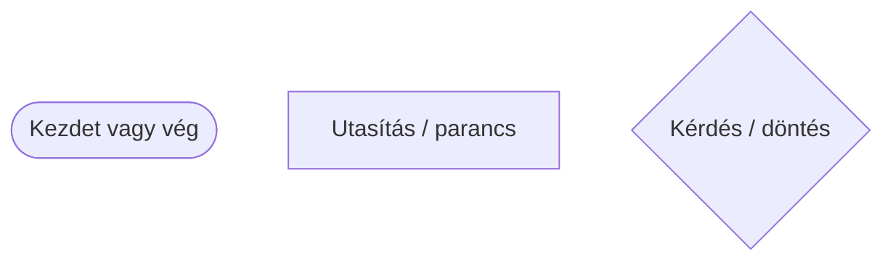
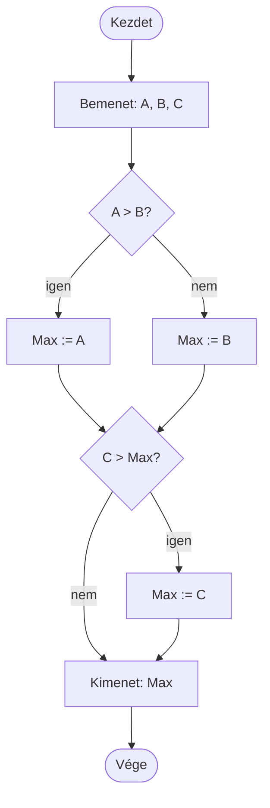

# Algoritmusok és Python – bevezetés

## Mi az algoritmus?

Az **algoritmus** egy lépésről lépésre követhető útmutató egy feladat megoldásához. A mindennapi életben is használunk algoritmusokat. Leírhatjuk szóban, szöveggel, rajzzal vagy programozási nyelven. Olyan, mint egy recept.

Példa: hogyan szerzünk két filctollat?

## A három alapvető szerkezet

### 1. Szekvencia – lépések egymás után

- Menj be az irodába!
- Keresd meg a tanárt!
- Kérj tőle két filctollat!
- Hozd vissza a terembe!

### 2. Elágazás – döntés a helyzettől függően

- Menj be az irodába!
- Keresd meg a tanárt!
- **Ha** ott van, kérj tőle két filctollat.
- **Ha nincs ott**, keress máshol filctollat.
- Gyere vissza a terembe!

### 3. Iteráció (ciklus) – ismétlés

- Ismételd meg kétszer: kérj egy filctollat!

Az ismétlést ciklusnak is nevezzük. A három szerkezet kombinálható és egymásba ágyazható. A részletes `if`, `while` és `for` magyarázatok a saját leckéikben találhatók.

## Hogyan ábrázoljuk az algoritmust?

Az algoritmust leírhatjuk szavakkal, folyamatábrával vagy struktúrogrammal. A folyamatábra olyan, mint egy térkép a program számára.



### Példa: a legnagyobb szám kiválasztása három szám közül

A `:=` jel jelentése itt: „legyen egyenlő”.



## Az algoritmus fontos tulajdonságai

### Általánosság

Az algoritmus legyen használható több hasonló feladatra, ne csak egyetlen konkrét esetre. Például egy négyzet területét ne csak egy adott méretre tudjuk kiszámítani.

### Megbízhatóság

Ugyanazokból az adatokból ugyanazt az eredményt kell kapnunk. Például 5 + 3 mindig 8.

## Mi az a Python?

A Python egy programozási nyelv, amellyel utasításokat írunk a számítógépnek. Ingyenesen használható, több operációs rendszeren működik, és sokféle feladatra alkalmazható, például játékok, weboldalak vagy adatelemző programok készítésére.

Egy egyszerű Python-program így néz ki:

```python
print("Hello!")
```

A `print()` kiírja a zárójelben megadott szöveget. A Pythonban a kódot általában `.py` végződésű fájlba írjuk, elmentjük, majd futtatjuk. A [VS Code útmutató](../00_VsCode_hu.md) bemutatja a használt fejlesztői környezetet.

## Egy kicsit összetettebb példa: végighaladás a betűkön

```python
nev = "Anna"
for betu in nev:
    print(betu)
```

Kimenet:

```text
A
n
n
a
```

A `for` ciklus sorban végigmegy a szöveg betűin, és minden betűt kiír. A ciklusokat részletesebben a `for` és `while` leckékben tanuljuk.

## Mit fogunk még megtanulni?

A tananyag során megtanuljuk kiírni az eredményeket (`print()`), adatokat beolvasni (`input()`), értékeket változókban tárolni, feltételek alapján dönteni, ciklusokat használni, majd szövegekkel, listákkal és függvényekkel dolgozni.

## Az eredeti tananyag további témái

A következő példa egy összetettebb Python-fájl részeit mutatja be. **Ezt most nem kell megtanulni vagy megérteni**; a függvények, osztályok, importok és a `__main__` rész későbbi témák.

```py
# Könyvtárak betöltése (ha szükséges)
import modul_nev
from masik_modul import fuggveny_nev

# Változók létrehozása (az egész programban használható)
global_valtozo = 10

# Osztályok definiálása
class Person:
    def __init__(self, name, surname):
        self.Name, self.Surname = name, surname

# Függvények definiálása
def fuggveny_nev(param1, param2):
    # Függvény törzse
    eredmeny = param1 + param2
    return eredmeny

# Fő programrész (main)
if __name__ == "__main__":
    # Parancssori argumentumok feldolgozása (opcionális)
    import sys
    argumentumok = sys.argv

    # Lokális változók deklarálása
    lokal_valtozo = "Hello, világ!"

    # Függvény hívás és eredmény kezelése
    eredmeny = fuggveny_nev(5, 3)
    print("Eredmény:", eredmeny)

    # Ciklusok, elágazások és más vezérlési szerkezetek
    if eredmeny > 5:
        print("Az eredmény nagyobb mint 5.")
    else:
        print("Az eredmény nem nagyobb mint 5.")

    for i in range(3):
        print("Ciklus:", i)

    # Bemenet olvasása és kiíratása
    input_text = input("Kérem, írjon be valamit: ")
    print("Bevitel:", input_text)

# Modulhoz tartozó kód (opcionális)
def masik_fuggveny():
    pass
```

## Milyen típusú adatokat tárolhatunk?

- `int` – egész számok (például `5`, `-3`, `100`)
- `str` – szöveg (például `"Hello"`, `"Péter"`)
- `float` – tizedes számok (például `3.14`, `-2.5`)
- `list` – több adatot tároló lista (például `[1, 2, 3]`)
- `dict` – kulcs–érték párokat tároló szótár (például `{"név": "Anna"}`)

Ezeket a típusokat későbbi leckékben részletesebben tanuljuk.