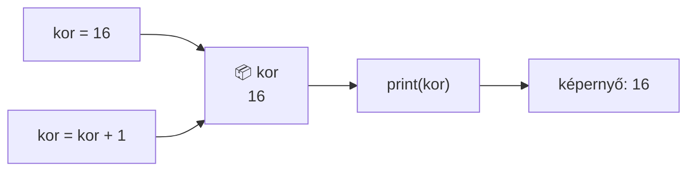
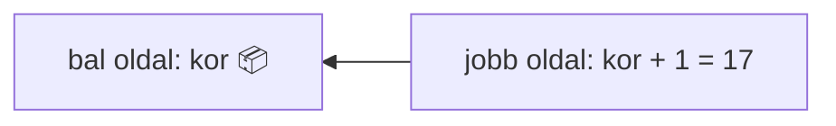

🗺️ [Vissza a tananyag térképéhez](../../Lessons_hu/00_Terkep_hu.md) · [Vissza a téma áttekintéséhez](README.md)

# Változók

- A változók a program azon elemei, amelyek különböző értékeket vehetnek fel, különböző adatok tárolására alkalmasak.
- Névvel ellátott memóriaterület
- Változó nevei lehetnek: x, z, szam, nev, lista

## Képzeljétek el így!
A változó olyan, mint egy **felcímkézett doboz** a polcon:

- a **címke** a változó neve (`kor`),
- a **doboz tartalma** a változó értéke (`16`),
- ha új dolgot teszünk bele, a régi **kiesik** – egy dobozban egyszerre egy érték van,
- a címkét felolvasva bármikor megnézhetjük, mi van benne.

Vagy gondolj a **ruhatárra**: leadod a kabátot, kapsz egy számot. A szám maga nem a kabát, de bármikor visszakérheted vele. A változó neve ez a ruhatári szám.



Az értékadás mindig **jobbról balra** működik: előbb kiszámolja a jobb oldalt, majd beteszi a bal oldali dobozba.



## Típusai 

| Típus | Jele | Mire való | Példa |
|---|---|---|---|
| **Szám** | `int` | egész számok tárolására | `10`, `-9`, `0` |
| **Tizedes szám** | `float` | tizedes számok tárolására (tizedes **pont**tal!) | `95.78`, `3.14`, `79.21` |
| **Karakterlánc** | `str` | szöveg, bármilyen karaktersorozat; `''` vagy `""` közé | `'alma'`, `'3gomb'`, `"Szia"` |
| **Logikai** | `bool` | igaz/hamis érték | `True`, `False` |

- A `float` esetében **pontot** használunk, nem vesszőt: `1.5` és nem `1,5`
- A `bool` két értéke: `True` – igaz, `False` – hamis. Figyelem, nagy kezdőbetűvel!
- A típust a `type()` függvénnyel kérdezhetjük le: `print(type(kor))`
# Műveletek
## Matematikai operátorok
- `5 + 3 = 8`összeg
- `5 – 3 = 2` különbség
- `5 * 3 = 15` szorzat
- `5 / 3 = 1.666` osztás
- `5 // 3 = 1` osztás egész része
- `5 % 3 = 2` osztás maradéka
- `5 ** 3 = 125` hatvány
- `sqrt(5)` négyzetgyökvonás (matematikai modul szükséges hozzá).

A négyzetgyökvonáshoz importálni kell a `math` modult, és a függvényt `math.sqrt()` alakban hívhatjuk:

```py
import math
print(math.sqrt(5))
```

Kimenet: `2.23606797749979`.

## Kerekítés
- `round` függvénnyel
- `round(a, x)`
- `a` – szám
- `x` - tizedes helyek száma

Pl. `round(12.345, 2)` eredménye `12.35`

Ha az `x`-et elhagyjuk, egész számra kerekít: `round(12.345)` eredménye `12`.

A szám helyére változó is írható!

## Logikai operátorok
A logikai operátorok lehetséges kimenetei:  `True`, `False`
- egyenlőség `==`, pl. X==5 – megvizsgáljuk `X` egyenlő-e `5`-tel
- kisebb `<`
- kisebb vagy egyenlő `<=`
- nagyobb `>`
- nagyobb vagy egyenlő `>=`
- nem egyenlő `!=`

Az értékadás **nem** logikai operátor: `=`, pl. `X=12` – az `X` változóba elmentjük a `12`-es értéket

# Program írásának szabályai
- Python-ban meg kell különböztetni a nagy és kisbetűt,
- A változók neve lehet betű szám és aláhúzás jel `_` kombinációja.
- A változók neve:
    - Nem kezdődhet számmal,
    - Nem tartalmazhat szóközt, tabulátort ,
    - Nem lehet rezervált szó(parancs, pl. Max, min, print, stb.)

## Korrekt változónév
```py
myvar = "John"  
my_var = "John"  
_my_var = "John"  
myVar = "John"  
MYVAR = "John"  
myvar2 = "John"
```
## Nem korrekt változónév, a program nem fut le
```py
2myvar = "John" #szammal kezdodik
my-var = "John" #kotojelet tartalmaz 
my var = "John" #szokozt tartalmaz
```

## Ajánlom a változók következő megnevezését
```py
my_var = "John"
myVar = "John"  
MyVar = "John"  
```

A feladatokat a [gyakorlófeladatok](05_exercises.md), a kérdéseket a [kérdések](04_questions.md) fájl tartalmazza.
