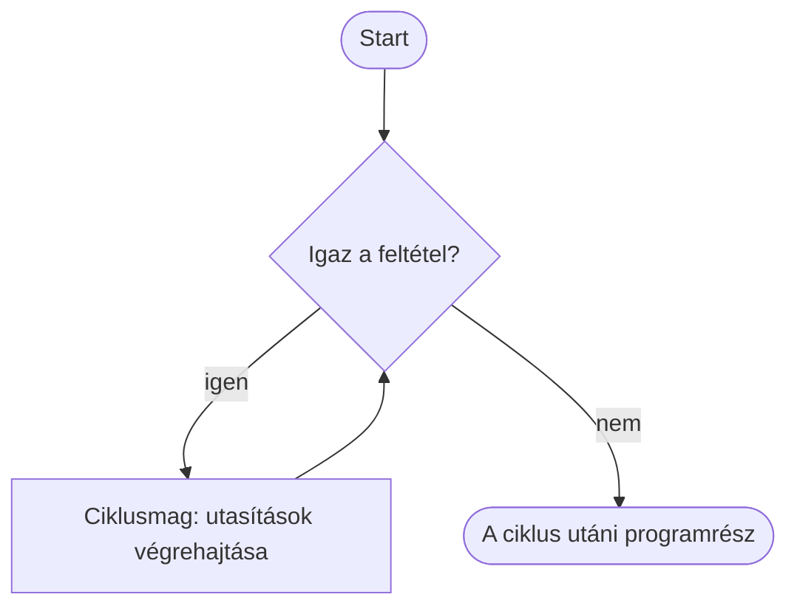

🗺️ [Vissza a tananyag térképéhez](../../Lessons_hu/00_Terkep_hu.md)

# Ciklusok és a `while`

## Mi a ciklus?

A ciklus olyan programszerkezet, amely egy utasításblokkot ismétel. Például: „amíg van pénzed, lépj egy mezőt”. Minden kör után újra ellenőrizzük a feltételt.



## A `while` és az `if`

Mindkettő feltételt vizsgál, de az `if` blokkja legfeljebb egyszer fut le, a `while` blokkja pedig ismétlődik, amíg a feltétel igaz.

```python
elet = 2

if elet > 0:
    print("A játék folytatódik.")

while elet > 0:
    print("Új kör kezdődik.")
    elet = elet - 1
```

Az `if` blokk egyszer ellenőrzi a feltételt. A `while` minden kör után újra ellenőrzi, és itt csökkentjük az életek számát, hogy a ciklus véget érjen.

## A `while` szintaxisa

```python
while feltetel:
    utasitas_1
    utasitas_2
```

A behúzott utasítások alkotják a **ciklusmagot**. A ciklusmag végén a program visszatér a `while` sorhoz, és újra ellenőrzi a feltételt.

## Számlálás

```python
i = 1
while i <= 5:
    print(i)
    i = i + 1
print("Vége")
```

Kimenet:
```text
1
2
3
4
5
Vége
``` Az `i = i + 1` módosítja a feltételben szereplő változót. Amikor `i` értéke 6 lesz, az `i <= 5` hamis, ezért a ciklus befejeződik.

## Végtelen ciklus

```python
i = 1
while i <= 5:
    print(i)
```

Ez a program nem áll le magától, mert `i` értéke nem változik, így a feltétel mindig igaz marad. Futó programot a terminálban a **Ctrl + C** billentyűkkel állíthatsz le.

## `break` és `continue`

- A `break` **azonnal befejezi a ciklust**, akkor is, ha a `while` feltétele egyébként még igaz lenne.
- A `continue` kihagyja az aktuális kör hátralévő részét, és a ciklus a következő körrel folytatódik.

### A `break` bemutatása

```python
i = 1
while i <= 5:
    print(i)
    if i == 3:
        break
    i = i + 1
print("Vége")
```

Kimenet:
```text
1
2
3
Vége
```

Amikor `i` értéke 3, a `break` azonnal kilép a ciklusból. A 4 és az 5 már nem jelenik meg, a ciklus utáni `print("Vége")` viszont lefut.

### A `continue` bemutatása

```python
i = 0
while i < 5:
    i = i + 1
    if i == 3:
        continue
    print(i)
```

Kimenet:
```text
1
2
4
5
```

A 3-at kihagyjuk, de a ciklus folytatódik.

### Tippelj futtatás előtt!

**A)** Mit ír ki a program, és mikor ér véget?

```python
i = 1
while i <= 5:
    if i == 3:
        break
    print(i)
    i = i + 1
print("Kész")
```

**B)** Melyik szám marad ki a kimenetből?

```python
i = 0
while i < 5:
    i = i + 1
    if i == 3:
        continue
    print(i)
```

Figyeld meg: a `continue` előtt növeljük az `i` értékét. Ha a növelés a `continue` után lenne, a 3-as értéknél a ciklus végtelenné válhatna.
