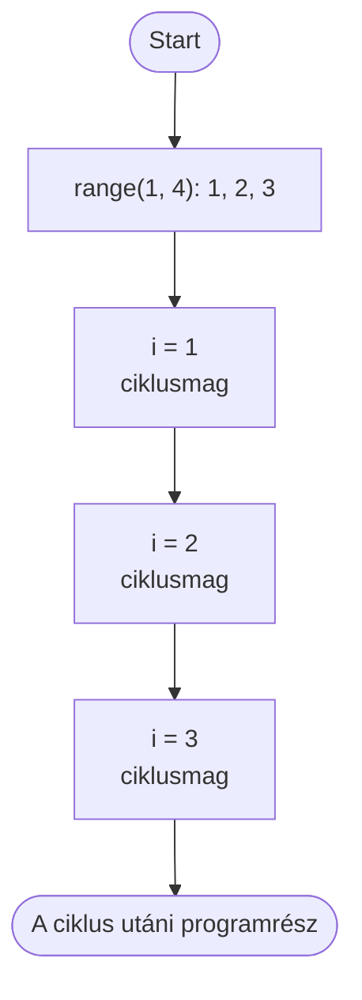

🗺️ [Vissza a tananyag térképéhez](../../Lessons_hu/00_Terkep_hu.md)

# Ciklus – `for`

A `while` ciklusnál nekünk kellett megváltoztatnunk a számlálót. A `for` ciklus ezt elvégzi helyettünk: sorban megkapja az értékeket egy tartományból.

## Rávezető kérdés

Ki kell írni az 1-től 20-ig terjedő számokat. Hogyan oldanátok meg `while` ciklussal? Mi lenne kényelmesebb, ha előre tudjuk, hogy pontosan melyik számokat szeretnénk?

Erre való a `for`: végigmegy egy előre megadott sorozaton.

## Szintaxis

```python
for ciklusvaltozo in range(kezdet, veg):
    utasitasok
```

- A `ciklusvaltozo` minden körben a következő értéket kapja. Egész számoknál gyakran `i` a neve.
- A `range()` állítja elő a számok sorozatát.
- Az `utasitasok` a ciklusmag: a behúzott blokk minden értékre lefut.

## `range()`: számsorozat

A `range()` felső határa mindig **nyitott**, vagyis nem része a sorozatnak.

```python
for i in range(1, 6):
    print(i)
```

Itt az `i` egymás után az `1`, `2`, `3`, `4`, `5` értéket kapja. A `6` már nem, mert a felső határ.

| Alak | Jelentés | Példa |
|---|---|---|
| `range(veg)` | 0-tól a `veg` előtti számig | `range(4)` → `0, 1, 2, 3` |
| `range(kezdet, veg)` | a `kezdet`-től a `veg` előtti számig | `range(2, 5)` → `2, 3, 4` |
| `range(kezdet, veg, lepes)` | adott lépésközzel | `range(0, 10, 2)` → `0, 2, 4, 6, 8` |

Visszafelé számoláshoz negatív lépés kell:

```python
for i in range(10, 0, -2):
    print(i)
```

Kimenet: `10, 8, 6, 4, 2`

## Példák

### Szám és négyzete

```python
for i in range(1, 6):
    print(i, i * i)
```

Kimenet:

```text
1 1
2 4
3 9
4 16
5 25
```

### Betűk bejárása

A `for` nemcsak számokon tud végigmenni. Egy szöveg betűi is sorozatot alkotnak:

```python
nev = "Anna"
for betu in nev:
    print(betu)
```

Kimenet:

```text
A
n
n
a
```

## Folyamatábra


