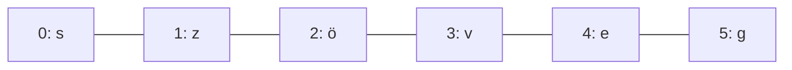

# String, karakterláncok és műveletek

## Mi az a string?

Eddig a stringet (szöveget) egyetlen egésznek kezeltük: `"szia"`. Valójában a string **karakterek sorozata** — mint a gyöngysor, ahol minden gyöngy egy betű, szám vagy jel.



Minden karakternek van egy **indexe**, a sorszáma, ami mindig **0-val kezdődik**. Ez az egyik leggyakoribb hibaforrás kezdőknek: az 1. karakter indexe nem 1, hanem 0.

```python
szoveg = "szöveg"
print(szoveg[3])
print(szoveg[1:])
print(szoveg[:4])
print(szoveg[1:len(szoveg)])
```

Kimenet:
```text
v
zöveg
szöv
zöveg
```

A szeletelésnél a kezdő index benne van, a záró index már nincs benne: `szoveg[1:4]` a 1., 2. és 3. indexű karaktert adja vissza.

## Karakterenkénti bejárás `for` ciklussal

A string kollekció, ezért a `for` ciklus közvetlenül végigmegy az összes karakterén:

```python
szoveg = "szöveg"
for karakter in szoveg:
    print(karakter)
```

Kimenet:
```text
s
z
ö
v
e
g
```

## `.lower()`

Kisbetűssé alakítja a szöveg betűit.

```python
text = "Pista elment a Tescoba."
textWithLower = text.lower()
print(f"{text}\\n{textWithLower}")
```

## `.upper()`

Nagybetűssé alakítja a szöveg betűit.

```python
text = "Pista elment a Tescoba."
textWithUpper = text.upper()
print(f"{text}\\n{textWithUpper}")
```

## `.replace(from, to)`

A megadott szövegrészt egy másikra cseréli. Az eredeti string nem változik meg; a metódus új stringet ad vissza.

```python
text = "Sps KN"
replacedText = text.replace("KN", "BA")
print(f"{text}\\n{replacedText}")
```

Kimenet:
```text
Sps KN
Sps BA
```

## `.split()`

Alapértelmezésben szóközök mentén feldarabolja a szöveget, és listát ad vissza.

```python
text = "The quick brown fox jumped over the lazy fox."
splitText = text.split()
print(f"{text}\\n{splitText}")
```

Kimenet:
```text
The quick brown fox jumped over the lazy fox.
['The', 'quick', 'brown', 'fox', 'jumped', 'over', 'the', 'lazy', 'fox.']
```

## `.split(".")` – darabolás adott karakter mentén

Ha paramétert adunk meg, a string annak mentén darabolódik. Az elválasztó nem kerül bele a részekbe; a végén levő pont miatt a példa utolsó eleme üres string lesz.

```python
text = "Once upon a time. He met a princess. They became friends."
print(text.split("."))
```

Kimenet:
```text
['Once upon a time', ' He met a princess', ' They became friends', '']
```

## `.index(substring)`

Megadja a keresett karakter vagy szövegrész első előfordulásának indexét. Ha nincs benne, `ValueError` hibát okoz.

```python
text = "They lived happily ever after."
searchedText = "lived"
print(text.index(searchedText))
```

Kimenet: `5`

## `.count(substring)`

Megadja, hányszor fordul elő a megadott karakter vagy szövegrész.

```python
text = "They lived happily ever after."
print(text.count("e"))
print(text.count("x"))
```

Kimenet:
```text
5
0
```

## `len(text)`

Visszaadja a string hosszát, vagyis a karakterek számát.

```python
text = "They lived happily ever after."
print(len(text))
```

Kimenet: `30`

## `elvalaszto.join(stringCollection)`

A `join()` metódust az elválasztó stringen hívjuk meg; a lista szövegelemeit összefűzi.

```python
text = "They lived happily ever after."
collection = text.split()
print("000".join(collection))
```

Kimenet: `They000lived000happily000ever000after.`

### Számok összefűzése stringgé

A `join()` csak stringeket tud összefűzni, ezért az egész számokat előbb szöveggé kell alakítani.

```python
numbers = [12, -4, 7]
numbersString = ":".join([str(n) for n in numbers])
print(numbersString)
```

Kimenet: `12:-4:7`

## `in` – tartalmazás vizsgálata

Az `in` kulcsszóval megvizsgálhatjuk, hogy egy karakter vagy résszöveg benne van-e a stringben.

```python
betu = input("Adj meg egy betűt: ")
maganhangzok = "aeiouAEIOU"
if betu in maganhangzok:
    print(betu, "magánhangzó")
else:
    print(betu, "nem szerepel a magánhangzók között")
```

## Stringek összehasonlítása

A `<` és `>` jelekkel stringeket is összehasonlíthatunk. Python a karakterek kódértékei alapján hasonlít, ezért a kis- és nagybetűk, illetve az ékezetes betűk sorrendje nem feltétlenül egyezik a magyar ábécé szerinti sorrenddel.

```python
limonade = "limonade"
szo = input("Írj be egy tetszőleges szót: ")
if szo < limonade:
    place = "megelőzi"
elif szo > limonade:
    place = "követi"
else:
    place = "megegyezik vele"
print(f"A '{szo}' szó {place} a '{limonade}' szóval összehasonlítva.")
```

## `str` mint kollekció

A szöveg feldarabolható karakterekre, és használható `for` ciklusban. Listává is alakítható.

```python
text = "test"
for c in text:
    print(c)

karakterLista = list(text)
print(karakterLista)
```

Kimenet:
```text
t
e
s
t
['t', 'e', 's', 't']
```
