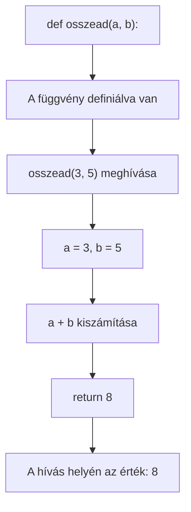

# Függvények

## Miért használunk függvényeket?

Ha ugyanazt a számítást több helyen kell elvégezni, nem kell ugyanazt a kódot újra és újra leírni. Elnevezzük a műveletet, és később a nevével meghívjuk. Így a program áttekinthetőbb, a javítást pedig elég egy helyen elvégezni.

## Függvény létrehozása és meghívása

A `def` kulcsszóval **definiáljuk** a függvényt. A behúzott sorok alkotják a függvény törzsét. A törzs csak akkor fut le, amikor meghívjuk a függvényt.

```python
def osszead(a, b) -> int:
    return a + b

eredmeny = osszead(3, 5)
print(eredmeny)  # 8
```

- `a` és `b` a **paraméterek**: ezek a függvény által fogadott bemenetek.
- A `osszead(3, 5)` hívásban a `3` és `5` az **argumentumok** (a ténylegesen átadott értékek).
- A `return a + b` visszaadja az eredményt a hívás helyére.
- A `-> int` típusjelölés: azt dokumentálja, hogy a függvény egész számot ad vissza. Nem kötelező, és önmagában nem ellenőrzi a visszatérési értéket.

### A függvény működése – folyamatábra



## Valós életből vett példa 1: éttermi számla

Tegyük fel, hogy egy étteremben a számla összegéhez 10% szervizdíjat kell hozzáadni. A számítást külön függvénybe tehetjük, így több számlánál is ugyanazt a szabályt használhatjuk.

```python
def szervizdijas_osszeg(alaposszeg):
    return alaposszeg * 1.10

szamla = szervizdijas_osszeg(25)
print(szamla)  # 27.500000000000004 (lebegőpontos kerekítés miatt)
print(round(szamla, 2))  # 27.5
```

A `szervizdijas_osszeg(25)` hívásnál a `25` az alapösszeg, a függvény pedig visszaadja a kiszámolt végösszeget. A függvény nem maga írja ki az eredményt: a `print()` a hívás eredményét jeleníti meg.

## Valós életből vett példa 2: utazási költség

Ha tudjuk a megtett kilométerek számát és az autó átlagfogyasztását, egy függvény kiszámíthatja az üzemanyag hozzávetőleges mennyiségét. A fogyasztás itt liter/100 km-ben értendő.

```python
def uzemanyag_liter(kilometer, liter_per_100_km):
    return kilometer * liter_per_100_km / 100

liter = uzemanyag_liter(240, 6.5)
print(round(liter, 2))  # 15.6
```

A függvény különböző utazásoknál is használható: csak a bemeneti értékek változnak.

## A `return` nem ugyanaz, mint a `print()`

Ez a különbség különösen fontos:

```python
def osszeg_print(a, b):
    print(a + b)

def osszeg_return(a, b):
    return a + b

x = osszeg_print(2, 3)   # kiírja: 5
y = osszeg_return(2, 3)  # y értéke 5
print(x)  # None
print(y)  # 5
```

- A `print()` megjelenít valamit a képernyőn.
- A `return` visszaad egy értéket, amelyet a hívó kód eltárolhat vagy további számításhoz használhat.
- Ha a függvény eléri a végét `return` nélkül, akkor `None` értékkel tér vissza.

## Paraméter nélküli függvény

Nem minden függvénynek kell bemenet.

```python
def koszones():
    return "Szia!"

uzenet = koszones()
print(uzenet)  # Szia!
```

## Csak műveletet végző függvény

Egy függvény kiírhat valamit vagy más műveletet végezhet anélkül, hogy hasznos értéket adna vissza.

```python
def koszon(nev):
    print(f"Szia, {nev}!")

koszon("Anna")  # Szia, Anna!
```

Az ilyen függvényt gyakran eljárásnak is nevezzük. Pythonban ez is függvény; ha nincs benne értéket visszaadó `return`, az eredménye `None`.

## Beépített függvények

A Python sok előre elkészített függvényt tartalmaz. Például a `min()` a legkisebb, a `max()` a legnagyobb, a `len()` pedig egy kollekció vagy szöveg hosszát adja meg.

```python
szamok = [8, 3, 12, 5]
print(min(szamok))  # 3
print(max(szamok))  # 12
print(len(szamok))  # 4
```

## Függvény hívása másik függvényen belül

Egy függvény eredményét átadhatjuk egy másik függvénynek.

```python
def osszead(a: int, b: int) -> int:
    return a + b

maximum = max(osszead(10, 5), osszead(-9, 13), osszead(9, 0))
print(maximum)  # 15
```

## Példa: prímszámvizsgálat

A függvény visszaadja a `True` vagy `False` értéket attól függően, hogy a szám prímszám-e.

```python
def prim_e(szam) -> bool:
    if szam < 2:
        return False
    for i in range(2, int(szam ** 0.5) + 1):
        if szam % i == 0:
            return False
    return True

szam = 20
if prim_e(szam):
    print(f"{szam} prímszám")
else:
    print(f"{szam} nem prímszám")
```

A `return False` az első osztónál befejezi a függvényt. Ha nem talál osztót, a ciklus után `return True` következik.
