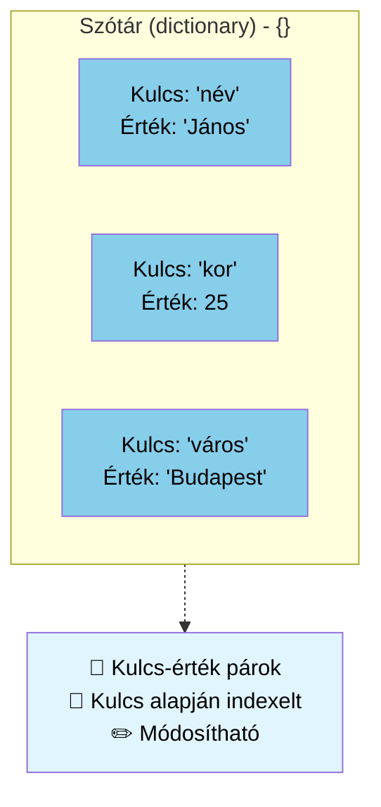

# Szótár `dictionary`: `{}`

```python
# Szótár - kulcs-érték párok
szemely = {'név': 'János', 'kor': 25, 'város': 'Budapest'}
print(f"\nSzótár: {szemely}")
print(f"Név: {szemely['név']}")
szemely['kor'] = 26  # Módosítható
print(f"Módosított szótár: {szemely}")
```
A szótár adatípus arra szolgál, hogy kulcs:érték párosokat mentsen el. A szótár olyan gyűjtemény, amely: 
- {kulcs:érték}, ahol a kulcs hash-elhető típusú (például szöveg vagy szám), az érték pedig bármilyen adattípus lehet; egy szótáron belül keveredhetnek is 
- ha egy értékhez akarunk hozzáférni, akkor a `[]` zárójeleket használjuk, mint a listáknál, éppenséggel itt a kulcsot adjuk meg: `print(myDict["key"])`
- sorba rendezett (Python >3.7)
- megváltoztatható
- nem tartalmaz kettőzött kulcsokat
## Példa kiírni az egész szótárat
```py
carDictionary = {
  "brand": "Ford",
  "model": "Mustang",
  "year": 1964,
}
print(carDictionary)
```
## Példa kiírni a kulcshoz tartozó értéket
```py
carDictionary = {
  "brand": "Ford",
  "model": "Mustang",
  "year": 1964
}
print(carDictionary["brand"])
```
esetleg
```py
brandKey = "brand"
carDictionary = {
  "brand": "Ford",
  "model": "Mustang",
  "year": 1964
}
print(carDictionary[brandKey])
```
## Példa megváltoztatni egy adott kulcshoz az értéket
```py
brandKey = "brand"
carDictionary = {
  "brand": "Ford",
  "model": "Mustang",
  "year": 1964
}
print(carDictionary[brandKey])
carDictionary[brandKey] = "Hyundai"
print(carDictionary[brandKey])
```

## Kettőzött kulcsok nem engedélyezettek
Hibát nem jelez ugyan, de mindig felülírja az értéket
```py
carDictionary = {
  "brand": "Ford",
  "model": "Mustang",
  "year": 1964,
  "year": 2020
}
print(carDictionary)
```
## Frissítés, `.update`
```py
carDictionary = {
  "brand": "Ford",
  "model": "Mustang",
  "year": 1964,
}
# ha létezik `model` kulcs, felülírja az értéket
carDictionary.update({"model":"Mondeo"})

# ha nem létezik `isElectric` kulcs, hozzácsatolja
carDictionary.update({"isElectric":False})

print(carDictionary)
```

## `.get`

Ha a szótár nem létező kulcsához akarunk hozzáférni, hibát jelez futtatásnál, a program leáll:
```py
carDictionary = {
  "brand": "Ford",
  "model": "Mustang",
  "year": 1964,
}
print(carDictionary["isElectric"])
```
Ezt megelőzendő használhatjuk a `.get` függvényt:

```py
carDictionary = {
  "brand": "Ford",
  "model": "Mustang",
  "year": 1964,
}
print(carDictionary.get("isElectric"))
print(carDictionary.get("isElectric", "nem tartalmazza"))
```
