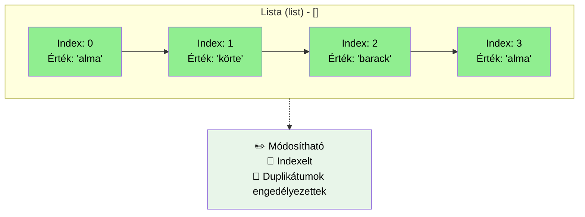

# Lista `list`: `[]`

```python
# Lista - indexelt, módosítható, duplikátumok engedélyezettek
gyumolcsok_lista = ['alma', 'körte', 'barack', 'alma']
print(f"Lista: {gyumolcsok_lista}")
print(f"Első elem: {gyumolcsok_lista[0]}")
gyumolcsok_lista[1] = 'szilva'  # Módosítható
print(f"Módosított lista: {gyumolcsok_lista}")
```
## Bejárás `for` ciklussal

A `for` ciklussal végigmehetünk a lista minden elemén:

```python
gyumolcsok = ['alma', 'körte', 'barack']
for gyumolcs in gyumolcsok:
    print(gyumolcs)
```

Kimenet:
```text
alma
körte
barack
```

## Tulajdonságok
- `[]` szögeletes zárójeleket használjuk
- különböző típusú elemeket is tartalmazhat; az elemeknek hash-elhetőnek kell lenniük, ezért például lista nem lehet halmazelem
  - `[1,2.3,"alma", True]` kevert
  - `[1,2,3]` csak számok
- index-szel jutunk hozzá az értékhez, `0`val kezdődik 
  - ha az egyenlőségjel "jobb" oldalán van az érték `ertek = listam[i]`, vagy nincs egyenlőségjel `print(listam[i])`, akkor **visszakapjuk** az értéket
  ```py
  lista = ['alma', 'korte', 'cseresznye']
  print(lista[1]) #kiirja korte
  alma = lista[0]
  print(alma)
  ```
  - ha az egyenlőségjel "bal" oldalán van az érték, akkor **hozzárendelünk** értéket
  ```py
  lista = ['alma', 'korte', 'cseresznye']
  print(lista[1]) #kiirja korte
  lista[1] = "kiwi"
  print(lista[1]) #kiirja kiwi
  ```
- `.append(érték)` - új értéket adunk a lista **végére**
- `.index(érték)` - visszaadja az `érték` **helyét**, sorszámát, indexét. Ha nem találja az értéket, akkor `ValueError` kivételt dob.
