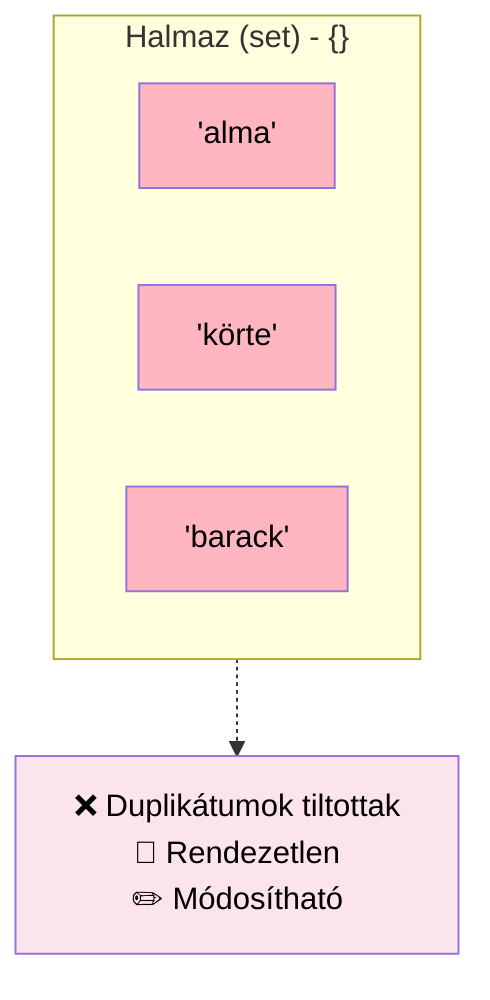

# Halmaz `set`: `{}`

```python
# Halmaz - rendezetlen, egyedi elemek, duplikátumok automatikusan törlődnek
gyumolcsok_halmaz = {'alma', 'körte', 'barack', 'alma'}
print(f"\nHalmaz: {gyumolcsok_halmaz}")  # 'alma' csak egyszer jelenik meg
```
A Python a `set` adattípust is alaptípusként definiálja. a `set`: elemek rendezetlen halmaza, amelyben minden elem **csak egyszer** fordulhat elő.

Alapvető használata: 
- megadott elem meglétének ellenőrzése
- elemek kettőzésének kiszűrése. 

## Tulajdonságok
- `{}` kapcsos zárójeleket használjuk, vagy a listából, stringből a `set()` paranccsal csinálunk halmazt `halmaz = set([1,1,1,2,3,5,4,4,4,8])`
- bármilyen adattípust tartalmazhat, akár keverve is
- minden eleme egyedi, csak egyszer fordul elő
## Példa
Hány számot találtam el a lottón:
```py
nyeroSzamok = {1, 2, 3, 4, 5, 6}
enSzamaim = {1, 2, 7, 8, 9, 0}

print("Ezeket eltalaltam: ", nyeroSzamok & enSzamaim)
```

## Listából halmaz
```py
kosar = ["alma", "narancs", "alma", "korte", "narancs", "banan"]
print("narancs" in kosar)
kosarHalmaz = set(kosar)
print(kosarHalmaz)
```

## Halmazok műveletei
A `set` objektumok támogatják az olyan matematikai műveleteket, mint az: 
- egyesítés (union), `a | b`
- közös metszet (intersection), `a & b`
- különbség (difference),  `a - b`
- és a szimmetrikus eltérés (symmetric difference). `a ^ b`

```py
abrakadabra = set('abracadabra')
alhambra = set('alhambra')
print(f'abrakadabra egyedi elemei {abrakadabra}')
print(f'alhambra egyedi elemei {alhambra}')
print(f'abrakadabra-ban benne van alhambra-bol hianyzik: {abrakadabra-alhambra}')
print(f'abrakadabra-ban vagy alhambra-ban megvan: {abrakadabra|alhambra}')
print(f'abrakadabra-ban es alhambra-ban megvan egyszerre: {abrakadabra&alhambra}')
print(f'abrakadabra-ban vagy alhambra-ban megvan, de egyszerre mindkettoben nem: {abrakadabra^alhambra}')
```
