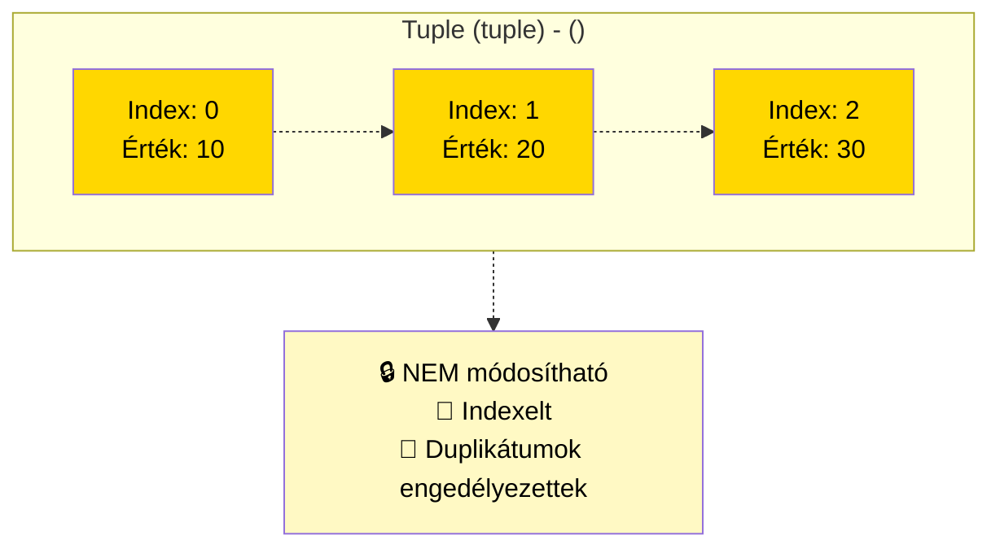

# Tuple `tuple`: `()`



```python
# Tuple - indexelt, NEM módosítható
koordinatak = (10, 20, 30)
print(f"\nTuple: {koordinatak}")
print(f"Első elem: {koordinatak[0]}")
# koordinatak[0] = 15  # Ez hibát okozna! Tuple nem módosítható
```

A **tuple** nem megváltoztatható adattípus, az elemei lehetnek megváltoztatható elemei. A kimeneten a tuple-k mindig zárójelezve vannak, így azok egymásba ágyazva is helyesen értelmezhetők; megadhatjuk zárójelekkel és anélkül is, néha azonban feltétlenül szükségesek a zárójelek (amikor az egy nagyobb kifejezés része).

Ilyen pl, ha egy **listát** teszünk a tuple-ba:
```py
megtanulni = ['matek', 'fizika']
orarendem = (megtanulni, 'tesi')

print(orarendem[0][1]) # fizika
orarendem[0][1] = 'szlovak' 
print(orarendem[0][1]) # szlovak
```
A következő kód hibát jelez:
```py
gyumolcsok = ('alma', 'korte', 'cseresznye')
gyumolcsok[0] = 'kiwi'
```

## Tulajdonságok
- `()` zárójeleket használjuk
- a tömb elemei nem változtathatók
- bármilyen adattípust használhatunk
- karakterláncokhoz hasonlóan megváltoztathatatlanok, nem adhatunk értéket egyetlen elemének (`myTuple[0] = 10` hibát jelez)
- létrehozható olyan tuple, amely megváltoztatható elemeket - például tömböket/listákat - tartalmaz (`myTuple = ([1,2,3],4)`, itt tudjuk a `myTuple[0]` értékeit változtatni, hiszen az egy lista )

## Mire jó? 

Függvény csak egy értéket adhat vissza, de ha az az egy érték olyan típus, ami több értéket tartalmaz, akkor épp a **tuple** lehet a megoldás. Szabályosan leírva:
```py
def Add10(a:int, b:int)->tuple[int,int]:
    return (a+10, b+10) 

result = Add10(40,50)
print(result)
```
Vagy egy kicsit egyszerűsítve, és felbontva a tuple-t két (vagy több) változóra
```py
def Add10(a:int, b:int)->tuple[int,int]:
    return a+10, b+10 # ilyenkor elmaradhat a zárójel

x, y = Add10(40,50)
print(x,y)
```
`(x, y)` koordinátapár tárolása, dolgozók rekordjai egy adatbázisban
