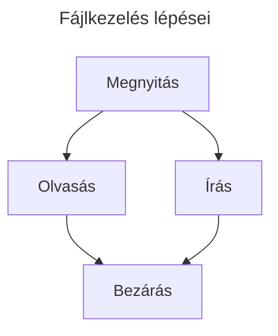

# Fájlkezelés

Az eddigi programjaink csak nagyon kevés adatot kezeltek, kétféleképpen vittünk be adatokat:
- billentyűzetről az `input` függvény segítségével
- véletlenszerűen generáltuk őket a `random` osztállyal

Amikor nagymennyiségű adatot akarunk kezelni, akkor jönnek kapóra a fájlok (adatbázisok).

## Fájlkezelés



## Fájl megnyitása `open()`

A `open()` függvénnyel fájlobjektumot kapunk, amelyen keresztül olvashatunk vagy írhatunk.

```py
f = open('munkafajl.txt', 'w')
f.close()
```

## Fájl megnyitásának módjai

| Módosító | Tulajdonság |
|---|---|
| `r` | A fájlt csak olvasásra nyitjuk meg; hibát jelez, ha írni próbálunk bele. |
| `w` | A fájlt csak írásra nyitjuk meg; a korábbi tartalmát felülírja, ha már létezik. |
| `a` | Hozzáfűzés céljából nyitjuk meg a fájlt. |
| `r+` | Egyszerre nyitja meg a fájlt írásra és olvasásra. |

További lehetőségek:

| Módosító | Tulajdonság |
|---|---|
| `t` | A fájlt szövegként nyitja meg; ez az alapértelmezett mód. |
| `b` | A fájlt binárisan nyitja meg. |

> Bináris megnyitás például: `f = open('munkafajl.txt', 'rb')`, ahol az `rb` jelentése read binary.

## Fájl olvasása

- `f.read(size)`
  - `size` hosszúságú karakterlánccal tér vissza.
  - A `size` elhagyása vagy negatív értéke esetén a teljes tartalmat visszaadja.
- `f.readline()`
  - Egy sort olvas ki a fájlból.
  - A sor végét az újsor karakter, `\n`, jelenti.
  - Megadhatjuk, mennyi karaktert akarunk kiolvasni a sorból.
- `f.readlines()`
  - Egy listával tér vissza, amely a fájl minden sorát tartalmazza.

### Kurzor mozgatása

`f.seek(léptetés, innen_kezdve)`
- Az `innen_kezdve` ponttól a megadott `léptetés` mennyiséggel mozgatja a kurzort.
- Az `innen_kezdve` lehetséges értékei:
  - `0` – a fájl eleje
  - `1` – az aktuális pozíció
  - `2` – a fájl vége
- Egy paraméter esetén az aktuális indexű pozícióra állítja a kurzort.

## Írás a fájlba

A `f.write("szöveg")` a zárójelbe írt szöveget írja a fájlba.

> A fájlba csak `str` adattípust tudunk írni. Ha más típusú értékünk van, akkor azt karakterlánccá kell alakítani, például: `str(10)`.

## Fájl bezárása

A `f.close()` bezárja a fájlt. A fájlokat használat után be kell zárni; a `with` blokk ezt automatikusan elvégzi.

## Példa

- Hozzunk létre egy `munkafajl.txt` állományt.
- Nyissuk meg, majd írjuk bele a következő szöveget: `"Ez egy tesztsor 12345"`.
- Majd olvassuk ki az állományba írt szöveget.

```py
f = open("munkafajl.txt", "w")
f.write("Ez egy tesztsor 12345")
f.close()

f = open("munkafajl.txt", "r")
a = f.read()
f.close()
print(a)
```

Kimenet:
```text
Ez egy tesztsor 12345
```

## A `.write()` függvény csak `str`-t fogad el

Ha számot vagy más adattípust akarunk a fájlba írni, előbb alakítsuk át `str`-ré, például `str(10)`.

## `os.path` függvény használata

> Ügyelni kell arra, hogy jó könyvtárba kerüljön a fájl. Az `os.path` segítségével meghatározhatjuk a Python-fájl könyvtárát.

```py
from os import path

fileName = "munkafajl.txt"
full_path = f"{path.dirname(__file__)}\\{fileName}"
```

- Az `os` könyvtárból a `path` modult importáljuk.
- `fileName` a fájl neve.
- `__file__` a futtatott Python-fájl elérési útját adja meg.
- A `path.dirname` ebből a könyvtár elérési útját adja vissza.

```py
from os import path

fileName = "munkafajl.txt"
full_path = f"{path.dirname(__file__)}\\{fileName}"

f = open(full_path, "w")
f.write("Ez egy tesztsor 12345")
f.close()

f = open(full_path, "r")
szoveg = f.read()
f.close()
print(szoveg)
```

Ezzel a függvénnyel a `.py` fájlunk mellett keresi, illetve hozza létre a fájlokat, nem a megnyitott munkalap (workspace) könyvtárában.

## Fájl olvasása soronként

```py
from os import path

fileName = "munkafajl.txt"
print(__file__)
full_path = f"{path.dirname(__file__)}\\{fileName}"

fajl = open(full_path, "r")
for sor in fajl.readlines():
    print(sor)
fajl.close()
```

A `for` ciklus egy szöveg minden karakterén is végig tud menni:

```py
for betu in "Python":
    print(betu)
```

Kimenet:
```text
P
y
t
h
o
n
```

## `with` parancs

A `with` parancs egyes objektumokat – például fájlokat – a blokk elhagyása után automatikusan bezár, így nem kell külön meghívni a `.close()` függvényt.

```py
from os import path

fileName = "munkafajl.txt"
print(__file__)
full_path = f"{path.dirname(__file__)}\\{fileName}"

with open(full_path, "r") as f:
    for sor in f.readlines():
        print(sor)
```
