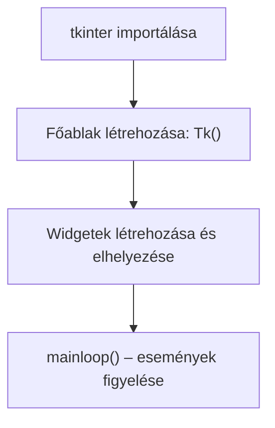

# Grafikus környezet Tkinter könyvtárral

A python programozási nyelv grafikus környezetével fogunk megismerkedni ebben a fejezetben. Több példát találtok [itt](https://www.pythontutorial.net/tkinter/), vagy másutt a neten. Alapjáraton a következő lépésekből áll egy ablak létrehozása:
1. a `tkinter` könyvtár importálása
2. a fő ablak, `root`, `parent` definiálása
3. egyes widgetek létrehozása, elhelyezése (`pack` vagy `grid` függvényekkel)
4. `mainloop`


## A grafikus ablak létrehozásának folyamata



## Ablak generálása
```py
import tkinter as tk

root = tk.Tk()
root.mainloop()
```

`as` paranccsal átnevezzük a könyvtárt, mikor a továbbiakban meghívjuk, nem `tkinter`-ként hivatkozunk rá, hanem `tk`-ként

`root` változóban mentjük el az ablak példányt, s a `mainloop` példányfüggvénnyel tartjuk nyitva, míg ki nem lépünk belőle.

### Ablak neve
```py
import tkinter as tk

root = tk.Tk()
root.title('Tkinter Window Demo')

root.mainloop()
```

### Ablak méretei
```py
import tkinter as tk

root = tk.Tk()
root.title('Tkinter Window Demo')
root.geometry('600x400+50+50')

root.mainloop()
```

ha az ablakot a képernyő közepére kívánod helyezni:
```py
import tkinter as tk


root = tk.Tk()
root.title('Tkinter Window - Center')

window_width = 300
window_height = 200

# get the screen dimension
screen_width = root.winfo_screenwidth()
screen_height = root.winfo_screenheight()

# find the center point
center_x = int(screen_width/2 - window_width / 2)
center_y = int(screen_height/2 - window_height / 2)

# set the position of the window to the center of the screen
root.geometry(f'{window_width}x{window_height}+{center_x}+{center_y}')

root.mainloop()
```

### Átlátszó ablak
```py
import tkinter as tk

root = tk.Tk()
root.title('Tkinter Window Demo')
root.geometry('600x400+50+50')
root.resizable(False, False)
root.attributes('-alpha', 0.5)

root.mainloop()
```

## Widget
Widget a grafikus környezet eleme, információt nyújt (`Label`), vagy éppen beviteli pontként szolgál (`Button`, `Text`). További információkért [itt](https://www.geeksforgeeks.org/what-are-widgets-in-tkinter/)

## Első `label`
```py
import tkinter as tk

root = tk.Tk()

message = tk.Label(root, text="Hello, World!")
message.pack()

root.mainloop()
```

1. Készítünk egy ablakot, amelyiket a `root` változóhoz rendeljük hozzá
2. készítünk egy `Label` widgetet, elemet, amelyiket a `root` ablakhoz kötünk, értéke pedig `Hello World!`
3. `pack` függvény helyezi el az ablakon belül a widgetet. 

## Gomb

Amint látni fogjátok, ahmikor egy `Button` widgetet hozunk létre, megadhatunk neki egy `command` parametert, amelyiket akkor fogja elsütni, mikor rákattintunk. Egy különbség van egy hagyományos függvénnyel való meghíváshoz képest: itt **csak a függvény nevét adjuk meg a zárójelek nélkül**!

### Egy gomb
```py
# pip install tkinter
import tkinter.font as font
import tkinter as tk

parent = tk.Tk()
parent.geometry("800x500")
myFont = font.Font(size=30)
parent.title("Title - button")
my_button = tk.Button(parent, text="Quit", height=1, width=35, command=parent.destroy)
my_button["font"] = myFont
my_button.pack()
parent.mainloop()
```

### Két gomb
```py
import tkinter as tk   

def write_text():
    print("Tkinter is easy to create GUI!")

parent = tk.Tk()
frame = tk.Frame(parent)
frame.pack()

text_disp= tk.Button(frame, text="Hello", command=write_text)

text_disp.pack(side=tk.LEFT)

exit_button = tk.Button(frame, text="Exit", fg="green",command=quit)
exit_button.pack(side=tk.RIGHT)

parent.mainloop()
```
## Gombok és függvények
```py
from tkinter import *

def Elore():
    global irany
    irany=1
    print(irany)

def Hatra():
    global irany
    irany=-1
    print(irany)
    
def Megall():
    global irany
    irany=0
    print(irany)

irany=0

root=Tk()
cim=Label(root,text=" _ globális változó átállítása _ ")
cim.pack(side=TOP)

gomb_kilepes=Button(root,text=' Kilépés ',bg="#FFB8B4",command=root.destroy)
gomb_kilepes.pack(side=BOTTOM)

gomb_elore=Button(root,text='elore',command=Elore)
gomb_elore.pack()

gomb_hatra=Button(root,text='hatra',command=Hatra)
gomb_hatra.pack()

gomb_megall=Button(root,text='STOP',command=Megall)
gomb_megall.pack()

root.mainloop()
```

## Extra, ha kíváncsi vagy

> Ez a rész **nem kötelező tananyag** — ha érdekel, hogyan lehet ennél sokkal többet is csinálni tkinterrel (animáció, időzítés, mozgó ablak), nézd át, de a fenti alapok nélküle is elegendők.

<details>
<summary>Négyzet megjelenítése (animáció Canvas-szal)</summary>

```py
#
from tkinter import *
from datetime import *


def idozit():
    global helyezes
    helyezes += 1
    if helyezes == 60:
        helyezes = 0
    hatter.coords(negyzet, 10 * helyezes + 90, 90, 10 * helyezes + 110, 110)
    hatter.after(20, idozit)

helyezes = 0

root = Tk()
root.title(" secundum ")

hatter = Canvas(root, bg="lightgreen", height=200, width=900)
hatter.pack(expand=True, side=TOP, padx=4, pady=4)
negyzet = hatter.create_rectangle(90, 90, 110, 110, fill="red")

hatter.after(1, idozit)
root.mainloop()

```
</details>

<details>
<summary>Ugráló ablak</summary>

```py
from tkinter import *
import random as m

foAblak = Tk()
foAblak.geometry("400x100+500+200")
foAblak.title("Ugralni Fogok.")

uzenet = Label(foAblak, text="Kapj el, ha tudsz!", font=("Arial", 18), width=16)
uzenet.pack(side=RIGHT, padx=10, pady=5)

foAblak.resizable(True, True)

def ugral():
    a = m.randrange(100, 2000)
    b = m.randrange(100, 1000)
    c = m.randrange(1000)
    d = m.randrange(800)
    am = "{}x{}+{}+{}".format(a, b, c, d)
    foAblak.geometry(am)
    foAblak.after(2000, ugral)


foAblak.after(1000, ugral)
foAblak.mainloop()
```
</details>

<details>
<summary>Digitális óra</summary>

```py
from tkinter import *
from datetime import *

curtime = ""
root = Tk()
root.title("Digital Clock")
root.geometry("297x205")

keret = Frame(root, bd=10, bg="#FFF", pady=4)
keret.pack(side=TOP)
gombv = Button(root, text="- vege -", bg="#AAE", command=root.destroy, padx=4, pady=2)
gombv.pack(side=BOTTOM)
datum = Label(keret, fg="#D11", bg="#CCC", font=("helvetica", 30, "italic"), padx=10, pady=2)
datum.pack(side=TOP)
clock = Label(keret, fg="#1A1", bg="#FFF", padx=10, pady=2, font=("helvetica", 40, "bold"))
clock.pack(side=BOTTOM)


def tick():
    global curtime
    aktual = datetime.now()
    newtime = aktual.strftime("%H:%M:%S")
    datumv = aktual.strftime("%Y.%m.%d")
    curtime = newtime
    clock.config(text=curtime)
    datum.config(text=datumv)
    datum.after(990, tick)


tick()
root.mainloop()

```
</details>


## A `for` ciklus végigmegy a szöveg karakterein

```py
for betu in "Tkinter":
    print(betu)
```

Kimenet:
```text
T
k
i
n
t
e
r
```
