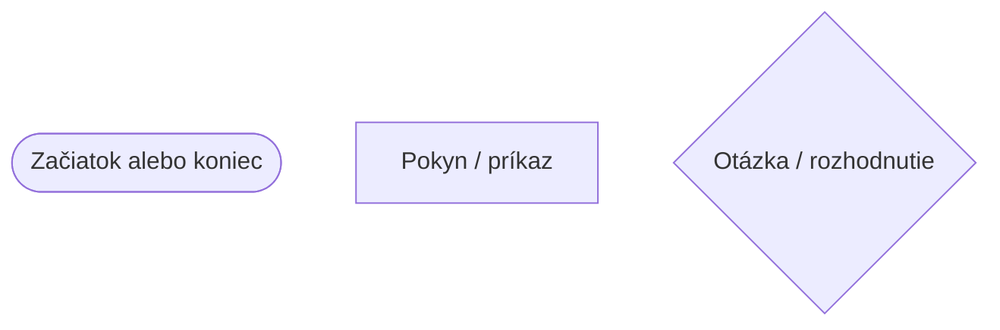
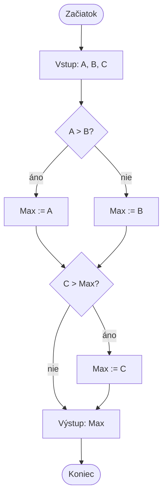

# Algoritmy a Python – úvod

## Čo je algoritmus?

**Algoritmus** je návod, ktorý krok za krokom opisuje riešenie úlohy. Algoritmy používame aj v každodennom živote. Môžeme ich opísať slovami, textom, obrázkom alebo programovacím jazykom. Sú ako recept.

Príklad: ako získať dva fixy?

## Tri základné štruktúry

### 1. Sekvencia – kroky za sebou

- Choď do kancelárie!
- Nájdi učiteľa!
- Požiadaj ho o dva fixy!
- Vráť sa do triedy!

### 2. Vetvenie – rozhodnutie podľa situácie

- Choď do kancelárie!
- Nájdi učiteľa!
- **Ak** tam je, požiadaj ho o dva fixy.
- **Ak tam nie je**, hľadaj fixy inde.
- Vráť sa do triedy!

### 3. Iterácia (cyklus) – opakovanie

- Zopakuj dvakrát: požiadaj o jeden fix!

Opakovanie nazývame aj cyklus. Tieto tri štruktúry možno kombinovať a vkladať do seba. Podrobné vysvetlenia `if`, `while` a `for` nájdeš v samostatných lekciách.

## Ako znázorníme algoritmus?

Algoritmus môžeme opísať slovami, vývojovým diagramom alebo štruktúrogramom. Vývojový diagram je ako mapa programu.



### Príklad: výber najväčšieho čísla z troch čísel

Znak `:=` tu znamená „nech sa rovná“.



## Dôležité vlastnosti algoritmu

### Univerzálnosť

Algoritmus by mal fungovať pre viac podobných úloh, nielen pre jeden konkrétny prípad. Napríklad vypočítame obsah ľubovoľného štvorca, nie iba jedného s pevnou veľkosťou.

### Spoľahlivosť

Pri rovnakých vstupných údajoch máme dostať rovnaký výsledok. Napríklad 5 + 3 je vždy 8.

## Čo je Python?

Python je programovací jazyk, v ktorom zapisujeme pokyny pre počítač. Je bezplatný, funguje na viacerých operačných systémoch a dá sa použiť na rôzne úlohy, napríklad tvorbu hier, webových stránok alebo analýzu údajov.

Jednoduchý Python program vyzerá takto:

```python
print("Hello!")
```

Funkcia `print()` vypíše text v zátvorkách. Kód zvyčajne zapisujeme do súboru s príponou `.py`, uložíme ho a spustíme. [Návod na VS Code](../00_VsCode_sk.md) predstavuje vývojové prostredie, ktoré používame.

## Trochu zložitejší príklad: prechod cez písmená

```python
meno = "Anna"
for pismeno in meno:
    print(pismeno)
```

Výstup:

```text
A
n
n
a
```

Cyklus `for` postupne prechádza písmená textu a každé vypíše. Cykly podrobnejšie vysvetľujú samostatné lekcie `for` a `while`.

## Čo sa ešte naučíme?

V učive sa naučíme vypisovať výsledky (`print()`), načítavať údaje (`input()`), ukladať hodnoty do premenných, rozhodovať sa podľa podmienok, používať cykly a neskôr pracovať s textom, zoznamami a funkciami.

## Ďalšie časti programu – na neskôr

Nasledujúci príklad ukazuje časti zložitejšieho Python súboru. **Teraz sa to nemusíš učiť ani tomu rozumieť**; funkcie, triedy, importy a časť `__main__` prídu na rad neskôr.

```py
# Načítanie knižníc (ak ich potrebujeme)
import nazov_modulu
from iny_modul import nazov_funkcie

# Vytvorenie premenných (použiteľných v celom programe)
globalna_premenna = 10

# Definícia tried
class Osoba:
    def __init__(self, meno, priezvisko):
        self.Meno, self.Priezvisko = meno, priezvisko

# Definícia funkcií
def nazov_funkcie(param1, param2):
    # Telo funkcie
    vysledok = param1 + param2
    return vysledok

# Hlavná časť programu (main)
if __name__ == "__main__":
    # Spracovanie príkazového riadku (voliteľné)
    import sys
    argumenty = sys.argv

    # Deklarácia lokálnych premenných
    lokalna_premenna = "Ahoj, svet!"

    # Volanie funkcie a spracovanie výsledku
    vysledok = nazov_funkcie(5, 3)
    print("Výsledok:", vysledok)

    # Cykly, vetvenie a iné riadiace štruktúry
    if vysledok > 5:
        print("Výsledok je väčší ako 5.")
    else:
        print("Výsledok nie je väčší ako 5.")

    for i in range(3):
        print("Cyklus:", i)

    # Čítanie vstupu a výstupu
    vstupny_text = input("Prosím, napíšte niečo: ")
    print("Vstup:", vstupny_text)

# Kód patriaci k modulu (voliteľné)
def ina_funkcia():
    pass
```

## Aké typy údajov môžeme ukladať?

- `int` – celé čísla (napríklad `5`, `-3`, `100`)
- `str` – text (napríklad `"Ahoj"`, `"Peter"`)
- `float` – desatinné čísla (napríklad `3.14`, `-2.5`)
- `list` – zoznam viacerých údajov (napríklad `[1, 2, 3]`)
- `dict` – slovník dvojíc kľúč–hodnota (napríklad `{"meno": "Anna"}`)

Tieto typy podrobnejšie spoznáme v ďalších lekciách.