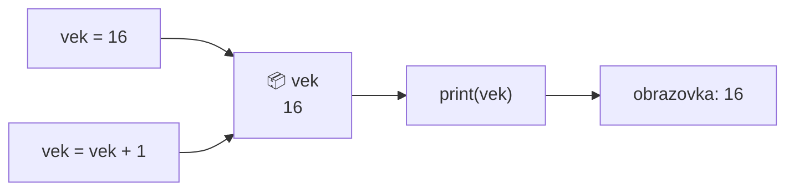
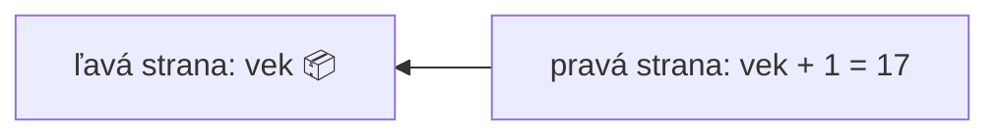

🗺️ [Späť na mapu učiva](../../Lessons_sk/00_Mapa_sk.md) · [Späť na prehľad témy](README.md)

# Premenné
- Premenné sú prvky programu, ktoré môžu nadobúdať rôzne hodnoty a slúžia na uchovávanie rôznych údajov.
- Menom označené miesto v pamäti
- Názov premennej môže byť: x, z, cislo, meno, zoznam

## Predstavte si to takto!
Premenná je ako **krabica s nálepkou** na polici:

- **nálepka** je názov premennej (`vek`),
- **obsah krabice** je hodnota premennej (`16`),
- keď doň vložíme niečo nové, staré **vypadne** – v jednej krabici je naraz jedna hodnota,
- prečítaním nálepky sa kedykoľvek pozrieme, čo je vnútri.

Alebo si spomeňte na **šatňu**: odovzdáte kabát a dostanete číslo. To číslo nie je kabát, ale kedykoľvek si ho podľa neho vypýtate. Názov premennej je toto šatňové číslo.



Priradenie funguje vždy **sprava doľava**: najprv sa vypočíta pravá strana, potom sa výsledok vloží do krabice na ľavej strane.



## Typy 

| Typ | Značka | Na čo slúži | Príklad |
|---|---|---|---|
| **Číslo** | `int` | na ukladanie celých čísel | `10`, `-9`, `0` |
| **Desatinné číslo** | `float` | na ukladanie desatinných čísel (s desatinnou **bodkou**!) | `95.78`, `3.14`, `79.21` |
| **Reťazec** | `str` | text, ľubovoľná postupnosť znakov; medzi `''` alebo `""` | `'jablko'`, `'3tlacitko'`, `"hram futbal"` |
| **Logická hodnota** | `bool` | pravda/nepravda | `True`, `False` |

- Pri type `float` používame desatinnú **bodku**, nie čiarku: `1.5` a nie `1,5`
- `bool` má dve hodnoty: `True` – pravda, `False` – nepravda. Pozor, s veľkým začiatočným písmenom!
- Typ zistíme funkciou `type()`: `print(type(vek))`

# Operácie
## Matematické operátory
- `5 + 3 = 8` súčet
- `5 - 3 = 2` rozdiel
- `5 * 3 = 15` súčin
- `5 / 3 = 1.6666666666666667` delenie
- `5 // 3 = 1` celočíselné delenie
- `5 % 3 = 2` zvyšok po delení
- `5 ** 3 = 125` umocňovanie
- `sqrt(5)` odmocnina (na to je potrebný matematický modul).

Na odmocňovanie treba importovať modul `math` a funkciu zavolať ako `math.sqrt()`:

```py
import math
print(math.sqrt(5))
```

Výstup: `2.23606797749979`.

## Zaokrúhlenie
- pomocou funkcie `round`
- `round(a, x)`
- `a` – číslo
- `x` - počet desatinných miest

Napr. `round(12.345, 2)` dáva výsledok `12.35`

Ak `x` vynecháme, zaokrúhli na celé číslo: `round(12.345)` dáva `12`.

Do miesta čísla môže ísť aj premenná!

## Logické operátory
možné výstupy logických operátorov: `True`, `False`
- rovnosť `==`, napr. X==5 – skontrolujeme, či sa X rovná 5
- menšie `<`
- menšie alebo rovné `<=`
- väčšie `>`
- väčšie alebo rovné `>=`
- nerovnosť `!=`

Priradenie **nie je** logický operátor `=` napr. `X=12` – premenná X sa nastaví na hodnotu 12

# Pravidlá písania programu
- V Pythone musíme rozlišovať medzi malými a veľkými písmenami,
- Názvy premenných môžu obsahovať písmená, číslice a podčiarkovník `_`.
- Názvy premenných:
    - Nesmú sa začínať číslom,
    - Nesmú obsahovať medzery, tabulátory,
    - Nesmú byť rezervované slová (príkazy), napr. `max`, `min`, `print`, atď.

## Správny názov pre premennú
```py
mojapremenna = "Janko"  
moja_premenna = "Janko"  
_moja_premenna = "Janko"  
mojaPremenna = "Janko"   
MojaPremenna = "Janko"  
MOJAPREMENNA = "Janko"  
mojaPremenna2 = "Janko"
```
## Nesprávny názov pre premennú, program sa nepustí
```py
2moja_premenna = "Janko" #zacina sa cislom  
moja-premenna = "Janko"  #obsahuje -
moja premenna = "Janko" #obsahuje medzeru
```

## Odporúčam používať
```py
moja_premenna = "Janko"
mojaPremenna = "Janko"  
MojaPremenna = "Janko"  
```

Úlohy nájdeš v súbore [Cvičenia](05_exercises.md) a otázky v súbore [Otázky](04_questions.md).
