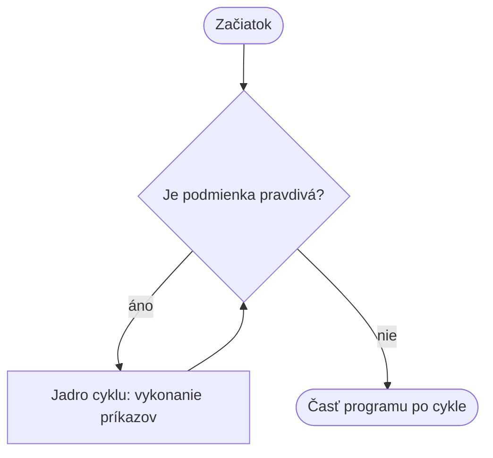

🗺️ [Späť na mapu učiva](../../Lessons_sk/00_Mapa_sk.md)

# Cykly a `while`

## Čo je cyklus?

Cyklus je programová konštrukcia, ktorá opakuje blok príkazov. Napríklad: „kým máš peniaze, posuň sa o jedno políčko“. Po každom kole znova skontrolujeme podmienku.



## Súvislosť `while` s `if`

Oba príkazy skúmajú podmienku, ale blok `if` sa vykoná najviac raz, zatiaľ čo blok `while` sa opakuje, kým podmienka ostáva pravdivá.

```python
if zivot > 0:
    print("Hra pokračuje.")

while zivot > 0:
    print("Začína nové kolo.")
```

## Syntax `while`

```python
while podmienka:
    prikaz_1
    prikaz_2
```

Odsadené príkazy tvoria **jadro cyklu**. Po jeho vykonaní sa program vráti na riadok `while` a znova skontroluje podmienku.

## Počítanie

```python
i = 1
while i <= 5:
    print(i)
    i = i + 1
print("Koniec")
```

Výstupom sú čísla od 1 po 5 a potom „Koniec“. Riadok `i = i + 1` mení premennú v podmienke. Keď bude `i` rovné 6, podmienka `i <= 5` už nebude pravdivá a cyklus sa skončí.

## Nekonečný cyklus

```python
i = 1
while i <= 5:
    print(i)
```

Program sa sám nezastaví, pretože hodnota `i` sa nemení a podmienka ostáva pravdivá. Bežiaci program môžeš zastaviť v termináli klávesmi **Ctrl + C**.

## `break` a `continue`

- `break` **okamžite ukončí cyklus**, aj keď by podmienka `while` bola stále pravdivá.
- `continue` preskočí zvyšok aktuálneho kola a cyklus pokračuje ďalším kolom.

### Ukážka príkazu `break`

```python
i = 1
while i <= 5:
    print(i)
    if i == 3:
        break
    i = i + 1
print("Koniec")
```

Výstup:
```text
1
2
3
Koniec
```

Keď má `i` hodnotu 3, príkaz `break` okamžite ukončí cyklus. Čísla 4 a 5 sa už nevypíšu, ale `print("Koniec")` za cyklom sa vykoná.

### Ukážka príkazu `continue`

```python
i = 0
while i < 5:
    i = i + 1
    if i == 3:
        continue
    print(i)
```

Výstup: `1, 2, 4, 5` – číslo 3 sa preskočí, ale cyklus pokračuje.
