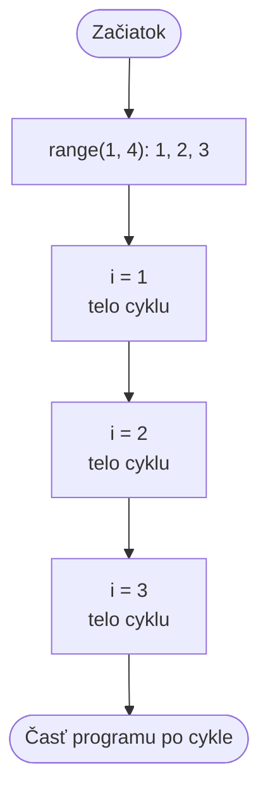

🗺️ [Späť na mapu učiva](../../Lessons_sk/00_Mapa_sk.md)

# Cyklus – `for`

Pri cykle `while` sme sami museli meniť počítadlo. Cyklus `for` to urobí za nás: postupne dostáva hodnoty z rozsahu.

## Úvodná otázka

Treba vypísať čísla od 1 do 20. Ako by ste to riešili cyklom `while`? Čo by bolo pohodlnejšie, ak vopred vieme presne, ktoré čísla chceme?

Práve na to slúži `for`: prejde vopred daný rad hodnôt.

## Syntax

```python
for premenna_cyklu in range(zaciatok, koniec):
    prikazy
```

- `premenna_cyklu` dostáva v každom kole nasledujúcu hodnotu. Pri celých číslach sa často volá `i`.
- `range()` vytvára postupnosť čísel.
- `prikazy` tvoria telo cyklu: odsadený blok sa vykoná pre každú hodnotu.

## `range()`: postupnosť čísel

Horná hranica `range()` je vždy **otvorená**, teda nie je súčasťou postupnosti.

```python
for i in range(1, 6):
    print(i)
```

Tu `i` postupne dostáva hodnoty `1`, `2`, `3`, `4`, `5`. Číslo `6` už nie, pretože je hornou hranicou.

| Tvar | Význam | Príklad |
|---|---|---|
| `range(koniec)` | od 0 po číslo pred `koniec` | `range(4)` → `0, 1, 2, 3` |
| `range(zaciatok, koniec)` | od `zaciatok` po číslo pred `koniec` | `range(2, 5)` → `2, 3, 4` |
| `range(zaciatok, koniec, krok)` | s daným krokom | `range(0, 10, 2)` → `0, 2, 4, 6, 8` |

Na počítanie odzadu potrebujeme záporný krok:

```python
for i in range(10, 0, -2):
    print(i)
```

Výstup: `10, 8, 6, 4, 2`

## Príklady

### Číslo a jeho druhá mocnina

```python
for i in range(1, 6):
    print(i, i * i)
```

Výstup:

```text
1 1
2 4
3 9
4 16
5 25
```

### Prechádzanie písmen

Cyklus `for` neprechádza len číslami. Aj písmená v texte tvoria postupnosť:

```python
meno = "Anna"
for pismeno in meno:
    print(pismeno)
```

Výstup:

```text
A
n
n
a
```

## `break` a `continue`

Príkaz `break` okamžite ukončí cyklus:

```python
for i in range(1, 10):
    if i == 5:
        break
    print(i)
```

Výstup: `1, 2, 3, 4`

Príkaz `continue` preskočí zvyšok aktuálneho kola a cyklus pokračuje ďalšou hodnotou:

```python
for i in range(1, 6):
    if i == 3:
        continue
    print(i)
```

Výstup: `1, 2, 4, 5`

## Vývojový diagram


