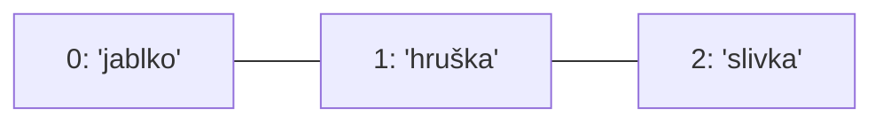

🗺️ [Späť na mapu učiva](../../Lessons_sk/00_Mapa_sk.md) · [Späť na prehľad témy](README.md)

# Zoznamy

Zoznam je dátový typ, ktorý uchováva viac hodnôt v jednej premennej. Môže obsahovať napríklad celé čísla, reťazce, desatinné čísla alebo aj iný zoznam.

```python
udaje = ["pondelok", "utorok", "streda", 1800]
print(udaje)
print(udaje[2])  # streda
```

## Prvky a indexy

Každý prvok má index, ktorý sa začína od 0. V zozname s tromi prvkami sú indexy 0, 1 a 2.

```python
ovocie = ["jablko", "hruška", "slivka"]
print(ovocie[0])  # jablko
print(ovocie[1])  # hruška
print(ovocie[2])  # slivka
```



Posledný prvok môžeme získať aj záporným indexom: `ovocie[-1]`. Ak použijeme index, ktorý neexistuje, dostaneme chybu `IndexError`.

## Zmena hodnoty prvku

Zoznam je meniteľný: hodnota existujúceho prvku sa dá zmeniť pomocou jeho indexu.

```python
udaje = ["pondelok", "utorok", "streda", 1800]
udaje[3] = udaje[3] + 47
print(udaje)  # ['pondelok', 'utorok', 'streda', 1847]

udaje[3] = "júl"
print(udaje)  # ['pondelok', 'utorok', 'streda', 'júl']
```

## Dĺžka zoznamu: `len(zoznam)`

`len()` je vstavaná funkcia volaná bez bodky. Zoznam dostane ako argument a vráti počet prvkov.

```python
ovocie = ["jablko", "hruška", "slivka"]
print(len(ovocie))  # 3
```

## Odstraňovanie prvkov

### `del zoznam[index]`

Pomocou príkazu `del` odstránime prvok podľa indexu.

```python
ovocie = ["jablko", "hruška", "slivka"]
del ovocie[1]
print(ovocie)  # ['jablko', 'slivka']
```

Príkaz `del zoznam[:]` odstráni všetky prvky, ale samotná premenná zoznamu zostane. Naopak, `del zoznam` odstráni premennú.

```python
cisla = [1, 2, 3]
del cisla[:]
print(cisla)  # []
```

### `zoznam.remove(hodnota)`

Metóda `.remove()` odstráni prvý prvok so zadanou hodnotou. Ak sa hodnota v zozname nenachádza, vznikne chyba `ValueError`.

```python
cisla = [4, 2, 4, 7]
cisla.remove(4)
print(cisla)  # [2, 4, 7]
```

### `zoznam.pop()` a `zoznam.pop(index)`

Metóda `.pop()` odstráni prvok a zároveň vráti jeho hodnotu. Bez indexu vyberie posledný prvok; s indexom vyberie prvok na zadanej pozícii.

```python
ovocie = ["jablko", "hruška", "slivka"]
hodnota = ovocie.pop()
print(ovocie)  # ['jablko', 'hruška']
print(hodnota) # slivka

prve = ovocie.pop(0)
print(prve)    # jablko
print(ovocie)  # ['hruška']
```

### `zoznam.clear()`

Metóda `.clear()` odstráni všetky prvky, ale premenná zostane ako prázdny zoznam.

```python
cisla = [1, 2, 3]
cisla.clear()
print(cisla)  # []
```

## Pridávanie prvkov

### `zoznam.append(hodnota)`

Metóda `.append()` pridá nový prvok na koniec zoznamu.

```python
ovocie = ["jablko", "hruška"]
ovocie.append("kiwi")
print(ovocie)  # ['jablko', 'hruška', 'kiwi']
```

### `zoznam.insert(index, hodnota)`

Metóda `.insert()` vloží nový prvok na zadaný index; ostatné prvky sa posunú.

```python
ovocie = ["jablko", "hruška", "slivka"]
ovocie.insert(1, "kiwi")
print(ovocie)  # ['jablko', 'kiwi', 'hruška', 'slivka']
```

### `zoznam.extend(iny_zoznam)`

Metóda `.extend()` pridá na koniec prvého zoznamu všetky prvky druhého zoznamu.

```python
prvy = [1, 2]
druhy = [3, 4]
prvy.extend(druhy)
print(prvy)  # [1, 2, 3, 4]
```

Nie je to to isté ako `.append(iny_zoznam)`: tým by sa celý druhý zoznam vložil ako jediný prvok.

## Hľadanie a počítanie

### `zoznam.index(hodnota)`

Metóda `.index()` vráti index **prvého výskytu** zadanej hodnoty. Ak sa hodnota nenájde, vyvolá chybu `ValueError`.

```python
farby = ["červená", "modrá", "zelená", "modrá"]
print(farby.index("modrá"))  # 1
```

### `zoznam.count(hodnota)`

Metóda `.count()` spočíta, koľkokrát sa hodnota nachádza v zozname.

```python
cisla = [1, 1, 2, 3, 4, 5, 5, 1]
print(cisla.count(1))  # 3
```

## Obrátenie poradia: `zoznam.reverse()`

Metóda `.reverse()` obráti poradie prvkov priamo v zozname; nezoradí ich vzostupne ani zostupne.

```python
cisla = [3, 1, 4, 2]
cisla.reverse()
print(cisla)  # [2, 4, 1, 3]
```

## Triedenie: `zoznam.sort()` a `sorted(zoznam)`

Oba zápisy dokážu zoradiť prvky, ale fungujú odlišne.

### `zoznam.sort()` – metóda, zoradí zoznam na mieste

```python
cisla = [1, 2, 3, 4, -5, 98, 565, -3]
cisla.sort()
print(cisla)  # [-5, -3, 1, 2, 3, 4, 98, 565]

cisla.sort(reverse=True)
print(cisla)  # [565, 98, 4, 3, 2, 1, -3, -5]
```

Metóda `.sort()` mení existujúci zoznam priamo.

### `sorted(zoznam)` – funkcia, vráti nový zoznam

```python
cisla = [3, 1, 2]
zoradene = sorted(cisla)

print(cisla)    # [3, 1, 2]
print(zoradene) # [1, 2, 3]
print(sorted(cisla, reverse=True))  # [3, 2, 1]
```

Funkcia `sorted()` nemení pôvodný zoznam: vráti nový, zoradený zoznam. Ak chceš mať zoradené hodnoty aj v premennej, priraď výsledok: `cisla = sorted(cisla)`.

## Metódy volané s bodkou a funkcie volané bez bodky

Predtým, než sa budeme podrobne učiť triedy, stačí zapamätať si tento praktický rozdiel:

| Zápis | Príklady | Čo robí? |
|---|---|---|
| Metóda zoznamu, s bodkou | `zoznam.append(x)`, `zoznam.remove(x)`, `zoznam.sort()` | Vykoná operáciu zoznamu; mnohé takéto metódy zoznam menia. |
| Vstavaná funkcia, bez bodky | `len(zoznam)`, `min(zoznam)`, `max(zoznam)`, `sum(zoznam)`, `sorted(zoznam)` | Dostane zoznam ako argument a vráti výsledok. |

Funkcie `min()`, `max()` a `sum()` sú obzvlášť užitočné pri zoznamoch čísel. Na prázdnom zozname funkcie `min()` a `max()` vyvolajú chybu, preto ich používaj len pri neprázdnom zozname.

```python
cisla = [8, 3, 12, 5]
print(min(cisla))  # 3
print(max(cisla))  # 12
print(sum(cisla))  # 28
print(len(cisla)) # 4
print(sum(cisla) / len(cisla))  # 7.0 – priemer
```

Algoritmy na napĺňanie zoznamu, prechádzanie, hľadanie minima a maxima, výpočet priemeru a výmenu prvkov sú v súbore [02a – Algoritmy so zoznamami](02a_algorithms.md).
