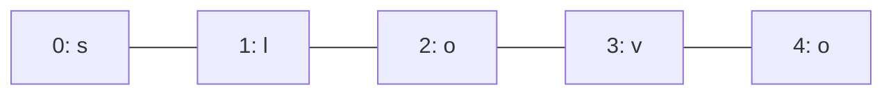

# String, reťazce a operácie

## Čo je reťazec?

Doteraz sme reťazec (text) vnímali ako jeden celok: `"ahoj"`. V skutočnosti je reťazec **postupnosť znakov** — ako retiazka, na ktorej je každá korálka písmeno, číslo alebo symbol.



Každý znak má svoj **index**, poradové číslo, ktoré sa začína od **0**. Prvý znak má teda index 0, nie 1.

```python
text = "slovo"
print(text[3])
print(text[1:])
print(text[:4])
print(text[1:len(text)])
```

Výstup:
```text
o
lovo
slov
lovo
```

Pri výreze je začiatočný index zahrnutý, koncový index už nie: `text[1:4]` vráti znaky s indexmi 1, 2 a 3.

## Prechádzanie cyklom `for` po jednotlivých znakoch

Reťazec je kolekcia, preto cyklus `for` prejde priamo cez všetky jeho znaky:

```python
text = "slovo"
for znak in text:
    print(znak)
```

Výstup:
```text
s
l
o
v
o
```

## `.lower()`

Vráti text s malými písmenami.

```python
text = "Pista elment a Tescoba."
textWithLower = text.lower()
print(f"{text}\\n{textWithLower}")
```

## `.upper()`

Vráti text s veľkými písmenami.

```python
text = "Pista elment a Tescoba."
textWithUpper = text.upper()
print(f"{text}\\n{textWithUpper}")
```

## `.replace(from, to)`

Nahradí zadanú časť textu inou. Pôvodný reťazec sa nezmení; metóda vráti nový reťazec.

```python
text = "Sps KN"
replacedText = text.replace("KN", "BA")
print(f"{text}\\n{replacedText}")
```

Výstup:
```text
Sps KN
Sps BA
```

## `.split()`

Predvolene rozdelí text podľa medzier a vráti zoznam.

```python
text = "The quick brown fox jumped over the lazy fox."
splitText = text.split()
print(f"{text}\\n{splitText}")
```

Výstup:
```text
The quick brown fox jumped over the lazy fox.
['The', 'quick', 'brown', 'fox', 'jumped', 'over', 'the', 'lazy', 'fox.']
```

## `.split(".")` – rozdelenie podľa zadaného znaku

Ak zadáme parameter, reťazec sa rozdelí podľa neho. Oddeľovač sa do častí nezahrnie; bodka na konci príkladu spôsobí, že posledným prvkom bude prázdny reťazec.

```python
text = "Once upon a time. He met a princess. They became friends."
print(text.split("."))
```

Výstup:
```text
['Once upon a time', ' He met a princess', ' They became friends', '']
```

## `.index(substring)`

Vráti index prvého výskytu znaku alebo podreťazca. Ak sa nenájde, vyvolá chybu `ValueError`.

```python
text = "They lived happily ever after."
searchedText = "lived"
print(text.index(searchedText))
```

Výstup: `5`

## `.count(substring)`

Vráti počet výskytov zadaného znaku alebo podreťazca.

```python
text = "They lived happily ever after."
print(text.count("e"))
print(text.count("x"))
```

Výstup:
```text
5
0
```

## `len(text)`

Vráti dĺžku reťazca, teda počet znakov.

```python
text = "They lived happily ever after."
print(len(text))
```

Výstup: `30`

## `oddelovac.join(stringCollection)`

Metódu `join()` voláme na oddeľovacom reťazci; spojí textové prvky zoznamu.

```python
text = "They lived happily ever after."
collection = text.split()
print("000".join(collection))
```

Výstup: `They000lived000happily000ever000after.`

### Spojenie čísel do reťazca

Metóda `join()` spája iba reťazce, preto treba čísla najprv previesť na text.

```python
numbers = [12, -4, 7]
numbersString = ":".join([str(n) for n in numbers])
print(numbersString)
```

Výstup: `12:-4:7`

## `in` – kontrola obsahu

Kľúčovým slovom `in` môžeme skontrolovať, či sa znak alebo podreťazec nachádza v reťazci.

```python
pismeno = input("Zadaj písmeno: ")
samohlasky = "aeiouAEIOU"
if pismeno in samohlasky:
    print(pismeno, "samohláska")
else:
    print(pismeno, "nie je medzi uvedenými samohláskami")
```

## Porovnávanie reťazcov

Reťazce možno porovnávať pomocou `<` a `>`. Python porovnáva kódové hodnoty znakov, preto poradie nemusí zodpovedať slovenskému abecednému poradiu; záleží aj na veľkosti písmen a diakritike.

```python
limonade = "limonade"
slovo = input("Zadaj ľubovoľné slovo: ")
if slovo < limonade:
    place = "pred"
elif slovo > limonade:
    place = "za"
else:
    place = "zhoduje sa s"
print(f"Slovo '{slovo}' sa pri porovnaní nachádza {place} slovom '{limonade}'.")
```

## `str` ako kolekcia

Text možno rozdeliť na jednotlivé znaky a použiť v cykle `for`. Dá sa tiež previesť na zoznam.

```python
text = "test"
for c in text:
    print(c)

zoznamZnakov = list(text)
print(zoznamZnakov)
```

Výstup:
```text
t
e
s
t
['t', 'e', 's', 't']
```
