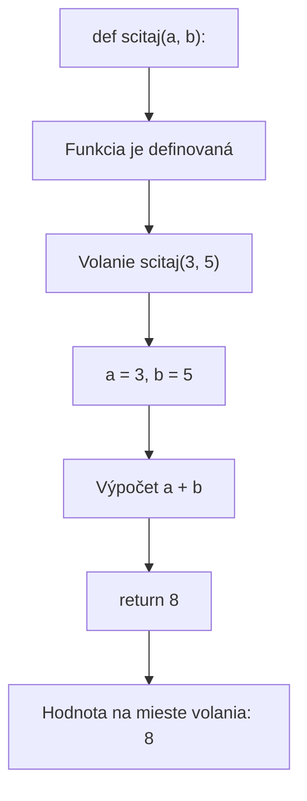

# Funkcie

## Prečo používame funkcie?

Ak potrebujeme rovnaký výpočet vykonať na viacerých miestach, nemusíme ten istý kód písať opakovane. Pomenujeme ho a neskôr ho zavoláme. Program je tak prehľadnejší a prípadnú opravu stačí vykonať na jednom mieste.

## Vytvorenie a zavolanie funkcie

Kľúčovým slovom `def` funkciu **definujeme**. Odsadené riadky tvoria jej telo. Telo sa vykoná až vtedy, keď funkciu zavoláme.

```python
def scitaj(a, b) -> int:
    return a + b

vysledok = scitaj(3, 5)
print(vysledok)  # 8
```

- `a` a `b` sú **parametre**: vstupy, ktoré funkcia prijíma.
- V zápise `scitaj(3, 5)` sú `3` a `5` **argumenty** – skutočné odovzdané hodnoty.
- `return a + b` vráti výsledok na miesto volania.
- `-> int` je typová anotácia: dokumentuje, že funkcia vracia celé číslo. Nie je povinná a sama nekontroluje návratovú hodnotu.

### Ako funkcia funguje – vývojový diagram



## Príklad z reálneho života 1: účet v reštaurácii

Predstavme si, že k účtu v reštaurácii treba pripočítať 10 % servisný poplatok. Výpočet môžeme vložiť do samostatnej funkcie a použiť ho pri viacerých účtoch.

```python
def suma_so_servisom(zakladna_suma):
    return zakladna_suma * 1.10

ucet = suma_so_servisom(25)
print(ucet)  # 27.500000000000004 (zaokrúhľovanie pri desatinných číslach)
print(round(ucet, 2))  # 27.5
```

Pri volaní `suma_so_servisom(25)` je `25` základná suma a funkcia vráti vypočítaný výsledok. Funkcia výsledok sama nevypisuje; `print()` zobrazí hodnotu, ktorú vráti volanie.

## Príklad z reálneho života 2: náklady na cestu

Ak poznáme počet prejdených kilometrov a priemernú spotrebu auta, funkcia môže vypočítať približné množstvo paliva. Spotreba je uvedená v litroch na 100 km.

```python
def palivo_litre(kilometre, litre_na_100_km):
    return kilometre * litre_na_100_km / 100

litre = palivo_litre(240, 6.5)
print(round(litre, 2))  # 15.6
```

Funkciu môžeme použiť pri rôznych cestách – menia sa iba vstupné hodnoty.

## `return` nie je to isté ako `print()`

Tento rozdiel je obzvlášť dôležitý:

```python
def sucet_print(a, b):
    print(a + b)

def sucet_return(a, b):
    return a + b

x = sucet_print(2, 3)   # vypíše: 5
y = sucet_return(2, 3)  # hodnota y je 5
print(x)  # None
print(y)  # 5
```

- `print()` zobrazí niečo na obrazovke.
- `return` vráti hodnotu, ktorú volajúci kód môže uložiť alebo použiť v ďalšom výpočte.
- Ak funkcia dosiahne koniec bez `return`, vráti hodnotu `None`.

## Funkcia bez parametrov

Nie každá funkcia potrebuje vstupné údaje.

```python
def pozdrav():
    return "Ahoj!"

sprava = pozdrav()
print(sprava)  # Ahoj!
```

## Funkcia, ktorá iba vykoná činnosť

Funkcia môže niečo vypísať alebo vykonať inú činnosť bez toho, aby vrátila užitočnú hodnotu.

```python
def pozdrav_meno(meno):
    print(f"Ahoj, {meno}!")

pozdrav_meno("Anna")  # Ahoj, Anna!
```

Takúto funkciu často nazývame aj postup. V Pythone je to stále funkcia; ak neobsahuje `return` s hodnotou, jej výsledkom je `None`.

## Vstavané funkcie

Python obsahuje veľa pripravených funkcií. Napríklad `min()` vráti najmenšiu hodnotu, `max()` najväčšiu a `len()` vráti dĺžku kolekcie alebo textu.

```python
cisla = [8, 3, 12, 5]
print(min(cisla))  # 3
print(max(cisla))  # 12
print(len(cisla))  # 4
```

## Volanie funkcie v inej funkcii

Výsledok jednej funkcie môžeme odovzdať inej funkcii.

```python
def scitaj(a: int, b: int) -> int:
    return a + b

maximum = max(scitaj(10, 5), scitaj(-9, 13), scitaj(9, 0))
print(maximum)  # 15
```

## Príklad: kontrola prvočísla

Funkcia vráti hodnotu `True` alebo `False` podľa toho, či je číslo prvočíslo.

```python
def je_prvocislo(cislo) -> bool:
    if cislo < 2:
        return False
    for i in range(2, int(cislo ** 0.5) + 1):
        if cislo % i == 0:
            return False
    return True

cislo = 20
if je_prvocislo(cislo):
    print(f"{cislo} je prvočíslo")
else:
    print(f"{cislo} nie je prvočíslo")
```

Príkaz `return False` ukončí funkciu hneď po nájdení deliteľa. Ak cyklus nenájde deliteľa, nasleduje `return True`.
