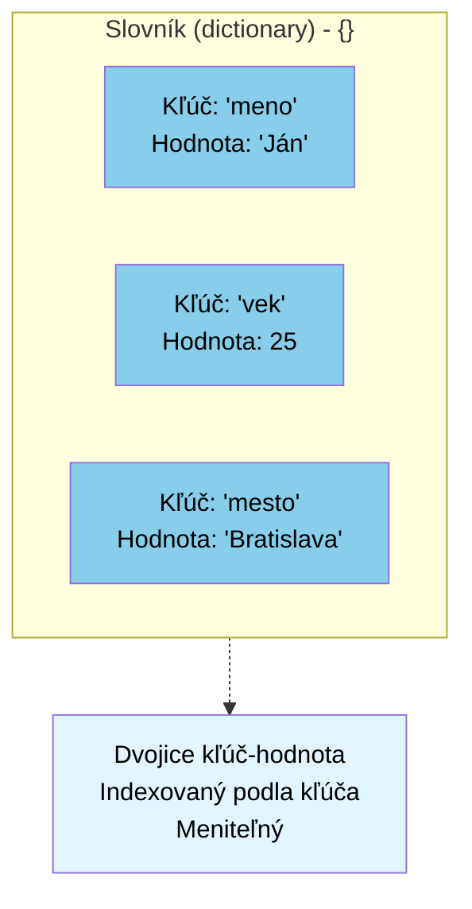

# Slovník `dictionary`: `{k:v}`

```python
# Slovník - kľúč-hodnota páry
osoba = {'meno': 'Ján', 'vek': 25, 'mesto': 'Bratislava'}
print(f"\nSlovník: {osoba}")
print(f"Meno: {osoba['meno']}")
osoba['vek'] = 26  # Modifikovateľný
print(f"Modifikovaná slovník: {osoba}")
```
Dátový typ slovník slúži na ukladanie párov `kľúč:hodnota`. Slovník je kolekcia, kde:
- `{kľúč:hodnota}`, pričom kľúč musí byť hashovateľný (napríklad text alebo číslo), hodnota môže byť ľubovoľného dátového typu; typy sa môžu v jednom slovníku miešať
- na prístup k hodnote používame zátvorky `[]`, rovnako ako pri zoznamoch, pricom tu uvádzame kľúč: `print(mojSlovnik["kluc"])`
- je zoradený (od Pythonu verzie >3.7)
- je modifikovateľný
- neobsahuje duplicitný kľúče

## Príklad výpisu celého slovníka
```py
autoSlovnik = {
  "znacka": "Ford",
  "model": "Mustang",
  "rok": 1964,
}
print(autoSlovnik)
```
## Príklad výpisu hodnoty pre dané kľúč
```py
autoSlovnik = {
  "znacka": "Ford",
  "model": "Mustang",
  "rok": 1964
}
print(autoSlovnik["znacka"])
```
alebo
```py
znackaKluc = "znacka"
autoSlovnik = {
  "znacka": "Ford",
  "model": "Mustang",
  "rok": 1964
}
print(autoSlovnik[znackaKluc])
```
## Príklad zmeny hodnoty pre dané kľúč
```py
znackaKluc = "znacka"
autoSlovnik = {
  "znacka": "Ford",
  "model": "Mustang",
  "rok": 1964
}
print(autoSlovnik[znackaKluc])
autoSlovnik[znackaKluc] = "Hyundai"
print(autoSlovnik[znackaKluc])
```

## Kľúče s duplicitami nie sú povolené
Neoznámi chybu, ale vždy prepíše hodnotu
```py
autoSlovnik = {
  "znacka": "Ford",
  "model": "Mustang",
  "rok": 1964,
  "rok": 2020
}
print(autoSlovnik)
```
## Aktualizácia, `.update`
```py
autoSlovnik = {
  "znacka": "Ford",
  "model": "Mustang",
  "rok": 1964,
}
# ak existuje kľúč model, prepíše hodnotu
autoSlovnik.update({"model":"Mondeo"})

# ak neexistuje kľúč model, pripojí ho
autoSlovnik.update({"jeElektricke":False})

print(autoSlovnik)
```

## `.get`
Ak chceme pristupovat k neexistujúcemu kľúču v slovníku, program signalizuje chybu a zastaví sa:

```py
autoSlovnik = {
  "znacka": "Ford",
  "model": "Mustang",
  "rok": 1964,
}
print(autoSlovnik["isElectric"])
```

Aby sme tomu predišli, môžeme použiť funkciu `.get`:

```py
autoSlovnik = {
  "znacka": "Ford",
  "model": "Mustang",
  "rok": 1964,
}
print(autoSlovnik.get("isElectric"))
print(autoSlovnik.get("isElectric", "neobsahuje"))
```
