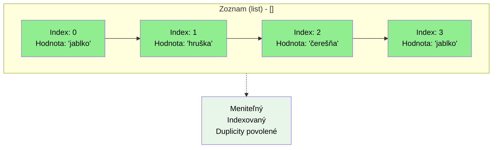

# Zoznam `list`: `[]`

```python
# Zoznam - indexované, modifikovateľný, duplikáty povolené
ovocie_zoznam = ['jablko', 'hruška', 'čerešňa', 'jablko']
print(f"Zoznam: {ovocie_zoznam}")
print(f"Prvý prvok: {ovocie_zoznam[0]}")
ovocie_zoznam[1] = 'slivka'  # Modifikovateľný
print(f"Modifikovaná zoznam: {ovocie_zoznam}")
```
## Prechádzanie pomocou cyklu `for`

Cyklus `for` prejde každý prvok zoznamu:

```python
ovocie = ['jablko', 'hruška', 'čerešňa']
for plod in ovocie:
    print(plod)
```

Výstup:
```text
jablko
hruška
čerešňa
```

## Vlastnosti
- Používame hranaté zátvorky `[]`
- Môže obsahovat ľubovoľný dátový typ, aj zmiešane
  - `[1,2.3,"jablko", True]` zmiešané
  - `[1,2,3]` len čísla
- Prístup k hodnote je indexované, začína od `0`
  - Ak je hodnota na "pravej" strane rovná sa `hodnota = zoznam[i]`, alebo len použijeme hodnotu `print(zoznam[i])`, **dostaneme** späť hodnotu prvka
  ```py
  zoznam = ['jablko', 'hruška', 'čerešňa']
  print(zoznam[1]) # vypíše hruška
  jablko = zoznam[0]
  print(jablko)
  ```
  - Ak je hodnota na "lavej" strane rovnátka, priradíme hodnotu
  ```py
  zoznam = ['jablko', 'hruška', 'čerešňa']
  print(zoznam[1]) # vypíše hruška
  zoznam[1] = "kiwi"
  print(zoznam[1]) # vypíše kiwi
  ```
- `.append(hodnota)` - pridá nové hodnotu na **koniec** zoznamu
- `.index(hodnota)` - vráti **pozíciu** `hodnoty`, ak ju nenájde, vyvolá `ValueError` výnimku
