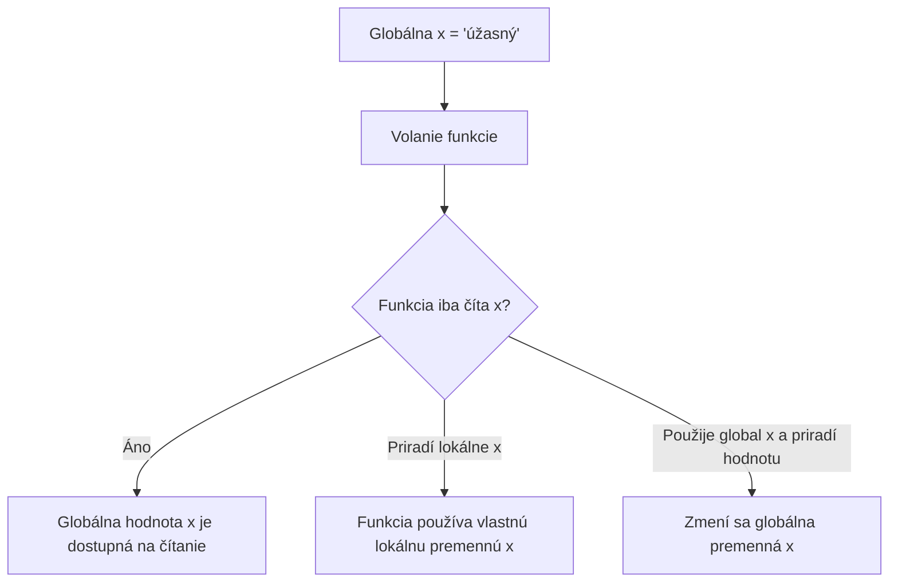

# Globálne a lokálne premenné

## Príklad z každodenného života

Predstav si, že si vedúci firmy a každému zamestnancovi musíš prideľovať rôzne úlohy. Na riadenie firmy používaš informačnú tabuľu, na ktorej sleduješ aktuálne úlohy zamestnancov. Predstav si, že zamestnanec pracuje na svojej úlohe, ale zakaždým, keď dostane novú úlohu, musí použiť tú istú tabuľu, aby získal všetky informácie. Je to únavné a neefektívne, pretože do jeho práce môžu zasahovať aj ostatní zamestnanci.

## Ako to súvisí s Pythonom?

Globálne premenné sú ako informačné tabule programu, ktoré sú dostupné na viacerých miestach. Ak funkcia používa globálne premenné, jej správanie môže závisieť od iných častí programu. Ak niekto zmení globálnu premennú, môže tým zmeniť aj správanie funkcie. To môže viesť k problémom, pretože funkcia nepracuje iba s hodnotami, ktoré dostala, ale aj s globálnym stavom celého programu.

## Prečo je lepšie používať parametre?

Parametre zabezpečujú, že funkcia pracuje s informáciami, ktoré jej odovzdáme. Je to podobné, ako keby každý zamestnanec dostal vlastný pracovný zošit, v ktorom má iba svoje úlohy. Program je tak predvídateľnejší a prehľadnejší a nemusíme sa obávať, že jeho správanie ovplyvnia iné časti programu.

## Ako vyzerá kód s globálnou premennou?

```python
x = 10  # globálna premenná

def zvys():
    global x
    x += 1
    print(x)

zvys()  # 11
zvys()  # 12
```

Použitím `global x` funkcia mení globálnu premennú `x`. Ak tú istú globálnu premennú mení viac funkcií, môžu navzájom ovplyvňovať svoje správanie.

## Ako vyzerá kód s parametrami?

```python
def zvys(x):
    x += 1
    print(x)
    return x

x = 10
x = zvys(x)  # 11
x = zvys(x)  # 12
```

Funkcia pracuje iba s hodnotou, ktorú dostala. Funkcia `zvys` priamo nemení globálnu premennú; vráti novú hodnotu, ktorú volajúci kód môže uložiť.

## Prečo je lepšie používať parametre?

1. **Menšia zložitosť:** globálne premenné môžu ľahko spôsobiť chyby, pretože ich možno meniť z rôznych miest. Pri parametroch je jasnejšie, na základe čoho funkcia pracuje.
2. **Čitateľnosť a údržba:** ak funkcia pracuje so svojimi parametrami, ľahšie pochopíme, čo robí. Netreba hľadať ďalšie časti programu, ktoré ju ovplyvňujú.
3. **Rozšíriteľnosť:** s parametrami možno program jednoduchšie rozširovať bez správy globálneho stavu.

Preto je vhodné uprednostniť parametre pred globálnymi premennými: program môže byť čistejší, zrozumiteľnejší a ľahšie udržiavateľný.

## Čítanie globálnej premennej vo funkcii

Premenné vytvorené mimo funkcií nazývame globálne premenné. Funkcia môže globálnu premennú čítať aj bez kľúčového slova `global`.

```python
x = "úžasný"

def moja_funkcia():
    print(f"Python je {x}")

moja_funkcia()
```

Výstup:
```text
Python je úžasný
```

### Rozsah premenných – prehľadný diagram



## Príklad: cyklus `for` prejde všetky písmená textu

Funkcia číta globálnu premennú `meno` a `pismeno` je premenná cyklu vo vnútri funkcie.

```python
meno = "Anna"

def vypis_pismena():
    for pismeno in meno:
        print(pismeno)

vypis_pismena()
```

Výstup:
```text
A
n
n
a
```

## Rozdiel medzi globálnou a lokálnou premennou

Ak vo funkcii vytvoríš premennú s rovnakým názvom, bude lokálna a použiteľná iba vo funkcii. Globálna premenná s rovnakým názvom si zachová pôvodnú hodnotu.

```python
x = "úžasný"

def moja_funkcia():
    x = "fantastický"
    print(f"Python je {x}")

moja_funkcia()
print(f"Python je {x}")
```

Výstup:
```text
Python je fantastický
Python je úžasný
```

Najprv funkcia vypíše svoj lokálny `x`, potom sa vypíše globálny `x`. Globálna premenná má stále hodnotu `úžasný`, zatiaľ čo lokálna premenná existuje iba vo funkcii.

## Kľúčové slovo `global`

Ak vo funkcii priradíme hodnotu premennej, Python ju považuje za lokálnu, pokiaľ pomocou kľúčového slova `global` neoznačíme, že chceme pracovať s globálnou premennou.

```python
def moja_funkcia():
    global x
    x = "fantastický"

moja_funkcia()
print("Python je " + x)
```

Výstup:
```text
Python je fantastický
```

## Zmena hodnoty globálnej premennej vo funkcii

Na zmenu globálnej premennej vo funkcii použijeme kľúčové slovo `global`:

```python
x = "úžasný"

def moja_funkcia():
    global x
    x = "fantastický"

moja_funkcia()
print("Python je " + x)
```

Výstup:
```text
Python je fantastický
```

V tomto príklade funkcia zmení hodnotu `x`, preto sa po jej zavolaní vypíše nová hodnota.
