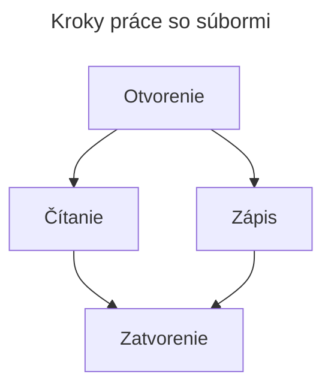

# Práca so súbormi

Naše doterajšie programy pracovali len s malým množstvom údajov. Údaje sme získavali dvoma spôsobmi:
- z klávesnice pomocou funkcie `input`
- náhodným generovaním pomocou triedy `random`

Keď chceme pracovať s veľkým množstvom údajov, prichádzajú na rad súbory (alebo databázy).

## Práca so súbormi



## Otvorenie súboru pomocou `open()`

Pomocou funkcie `open()` získame objekt súboru, cez ktorý môžeme čítať alebo zapisovať.

```py
f = open('pracovnysubor.txt', 'w')
f.close()
```

## Spôsoby otvorenia súboru

| Mód | Vlastnosť |
|---|---|
| `r` | Súbor otvárame iba na čítanie; pri pokuse o zápis vznikne chyba. |
| `w` | Súbor otvárame iba na zápis; ak už existuje, jeho predchádzajúci obsah sa prepíše. |
| `a` | Súbor otvárame na pridávanie obsahu na koniec. |
| `r+` | Súbor otvárame na čítanie aj zápis. |

Ďalšie možnosti:

| Mód | Vlastnosť |
|---|---|
| `t` | Súbor otvárame ako textový; je to predvolený režim. |
| `b` | Súbor otvárame v binárnom režime. |

> Príklad binárneho otvorenia: `f = open('pracovnysubor.txt', 'rb')`, kde `rb` znamená read binary.

## Čítanie zo súboru

- `f.read(size)`
  - Vráti reťazec dĺžky `size`.
  - Ak `size` vynecháme alebo zadáme zápornú hodnotu, vráti celý obsah.
- `f.readline()`
  - Načíta jeden riadok zo súboru.
  - Koniec riadku označuje znak nového riadku `\n`.
  - Môžeme určiť, koľko znakov chceme načítať.
- `f.readlines()`
  - Vráti zoznam obsahujúci všetky riadky súboru.

### Posúvanie kurzora

`f.seek(offset, from_where)`
- Posunie kurzor o hodnotu `offset` od miesta `from_where`.
- Hodnoty `from_where`:
  - `0` – začiatok súboru
  - `1` – aktuálna pozícia
  - `2` – koniec súboru
- Pri jednom parametri nastaví kurzor na pozíciu s daným indexom.

## Zápis do súboru

`f.write("text")` zapíše do súboru text uvedený v zátvorkách.

> Do súboru môžeme zapisovať iba hodnoty typu `str`. Ak máme inú hodnotu, najprv ju prevedieme na reťazec, napríklad `str(10)`.

## Zatvorenie súboru

`f.close()` zatvorí súbor. Súbory treba po použití zatvárať; blok `with` to urobí automaticky.

## Príklad

- Vytvorte súbor `pracovnysubor.txt`.
- Otvorte ho a zapíšte doň text `"Toto je testovací riadok 12345"`.
- Potom načítajte text zo súboru.

```py
f = open("pracovnysubor.txt", "w")
f.write("Toto je testovací riadok 12345")
f.close()

f = open("pracovnysubor.txt", "r")
a = f.read()
f.close()
print(a)
```

Výstup:
```text
Toto je testovací riadok 12345
```

## Funkcia `.write()` prijíma iba `str`

Ak chcete do súboru zapísať číslo alebo iný dátový typ, najprv ho preveďte na `str`, napríklad `str(10)`.

## Použitie `os.path`

> Dávajte pozor, do ktorého adresára sa súbor uloží. Pomocou `os.path` môžeme určiť adresár, v ktorom sa nachádza Python súbor.

```py
from os import path

fileName = "pracovnysubor.txt"
full_path = f"{path.dirname(__file__)}\\{fileName}"
```

- Z knižnice `os` importujeme modul `path`.
- `fileName` je názov súboru.
- `__file__` vráti cestu k spustenému Python súboru.
- `path.dirname` z tejto cesty vráti cestu k adresáru.

```py
from os import path

fileName = "pracovnysubor.txt"
full_path = f"{path.dirname(__file__)}\\{fileName}"

f = open(full_path, "w")
f.write("Toto je testovací riadok 12345")
f.close()

f = open(full_path, "r")
text = f.read()
f.close()
print(text)
```

Takto sa súbory vyhľadávajú alebo vytvárajú vedľa nášho súboru `.py`, nie v otvorenom pracovnom priestore (workspace).

## Čítanie súboru po riadkoch

```py
from os import path

fileName = "pracovnysubor.txt"
print(__file__)
full_path = f"{path.dirname(__file__)}\\{fileName}"

subor = open(full_path, "r")
for riadok in subor.readlines():
    print(riadok)
subor.close()
```

Cyklus `for` môže prejsť aj cez každý znak v texte:

```py
for pismeno in "Python":
    print(pismeno)
```

Výstup:
```text
P
y
t
h
o
n
```

## Príkaz `with`

Príkaz `with` po opustení bloku automaticky zatvorí niektoré objekty, napríklad súbory. Netreba preto osobitne volať `.close()`.

```py
from os import path

fileName = "pracovnysubor.txt"
print(__file__)
full_path = f"{path.dirname(__file__)}\\{fileName}"

with open(full_path, "r") as f:
    for riadok in f.readlines():
        print(riadok)
```
