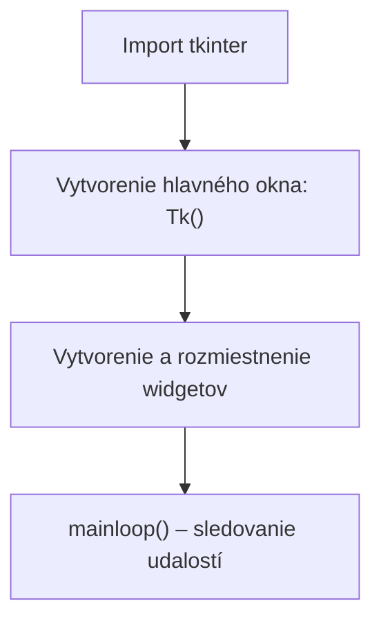

# Grafické prostredie s knižnicou Tkinter

V tejto kapitole sa zoznámime s grafickým prostredím programovacieho jazyka python. Viac príkladov nájdete [tu](https://www.pythontutorial.net/tkinter/) alebo inde na internete. Vytváranie okna pozostáva z nasledujúcich krokov:
1. Importujte adresár `tkinter`
2. Definujte hlavné okno, `root`, `parent`
3. Vytvorte a umiestnite jednotlivé widgety (s funkciami `pack` alebo `grid`)
4. `mainloop`


## Postup vytvorenia grafického okna



## Generovanie okna
```py
import tkinter as tk

root = tk.Tk()
root.mainloop()
```

`as` na premenovanie adresára, a keď sa vyvolá ďalej, neoznačujeme ho ako `tkinter`, ale ako `tk`

Uložte inštanciu okna do premennej `root` a použite funkciu inštancie `mainloop`, aby ste ju nechali otvorenú, kým ju neopustíte.

### Názov okna
```py
import tkinter as tk

root = tk.Tk()
root.title('Tkinter Window Demo')

root.mainloop()
```

### Veľkosť okna
```py
import tkinter as tk

root = tk.Tk()
root.title('Tkinter Window Demo')
root.geometry('600x400+50+50')

root.mainloop()
```

Ak chceš okno dať uprostred obrazovky:
```py
import tkinter as tk


root = tk.Tk()
root.title('Tkinter Window - Center')

window_width = 300
window_height = 200

# get the screen dimension
screen_width = root.winfo_screenwidth()
screen_height = root.winfo_screenheight()

# find the center point
center_x = int(screen_width/2 - window_width / 2)
center_y = int(screen_height/2 - window_height / 2)

# set the position of the window to the center of the screen
root.geometry(f'{window_width}x{window_height}+{center_x}+{center_y}')

root.mainloop()
```

### Priesvitné okno
```py
import tkinter as tk

root = tk.Tk()
root.title('Tkinter Window Demo')
root.geometry('600x400+50+50')
root.resizable(False, False)
root.attributes('-alpha', 0.5)

root.mainloop()
```

## Widget
Widget je prvok grafického prostredia, poskytuje informácie (`Label`) alebo slúži ako vstupný bod (`Button`, `Text`). Ďalšie informácie [tu](https://www.geeksforgeeks.org/what-are-widgets-in-tkinter/)

## Prvý `label`
```py
import tkinter as tk

root = tk.Tk()

message = tk.Label(root, text="Hello, World!")
message.pack()

root.mainloop()
```

1. Vytvoríme okno, ktoré priradíme k premennej `root`
2. vytvorte widget `Label` prepojený s oknom `root` a jeho hodnota je `Hello World!`
3. Funkcia `pack` umiestni widget do okna. 
## Tlačidlo

Ako uvidíte, keď vytvoríte miniaplikáciu `Button`, môžete jej dať parameter `command`, ktorý sa spustí, keď naň kliknete. V porovnaní s volaním s tradičnou funkciou je jeden rozdiel: tu **sa zadáva iba názov funkcie bez zátvoriek**!

### Jedno tlačidlo
```py
# pip install tkinter
import tkinter.font as font
import tkinter as tk

parent = tk.Tk()
parent.geometry("800x500")
myFont = font.Font(size=30)
parent.title("Title - button")
my_button = tk.Button(parent, text="Quit", height=1, width=35, command=parent.destroy)
my_button["font"] = myFont
my_button.pack()
parent.mainloop()
```

### Dve tlačidlá
```py
import tkinter as tk   

def write_text():
    print("Tkinter is easy to create GUI!")

parent = tk.Tk()
frame = tk.Frame(parent)
frame.pack()

text_disp= tk.Button(frame, text="Hello", command=write_text)

text_disp.pack(side=tk.LEFT)

exit_button = tk.Button(frame, text="Exit", fg="green",command=quit)
exit_button.pack(side=tk.RIGHT)

parent.mainloop()
```
### Vypísanie citátu
```py
# pip install tkinter

import tkinter as tk
from tkinter import END, Text
from tkinter.ttk import Button
import requests


def get_quote():
    r = requests.get("https://api.quotable.io/random")
    data = r.json()
    quote = data["content"]
    text_box.delete("1.0", END)
    text_box.insert(END, quote)


root = tk.Tk()
root.title("Quoter")
text_box = Text(root, height=10, width=50)
get_button = Button(root, text="Get Quote", command=get_quote)

text_box.pack()
get_button.pack()
root.mainloop()
```

## Tlačidlá a funkcie
```py
from tkinter import *

def Forward():
    global direction
    direction=1
    print(direction)

def Back():
    global direction
    direction=-1
    print(direction)
    
def Stop():
    global direction
    direction=0
    print(direction)

direction=0

root=Tk()
name=Label(root,text=" _ change the global variable _ ")
name.pack(side=TOP)

buttonClose=Button(root,text=' Exit ',bg="#FFB8B4",command=root.destroy)
buttonClose.pack(side=BOTTOM)

buttonForward=Button(root,text='Forward',command=Forward)
buttonForward.pack()

buttonBack=Button(root,text='Back',command=Back)
buttonBack.pack()

buttonStop=Button(root,text='STOP',command=Stop)
buttonStop.pack()

root.mainloop()
```

## Extra, ak si zvedavý

> Táto časť **nie je povinná** — ak ťa zaujíma, ako sa dá s tkinterom robiť oveľa viac (animácia, časovanie, pohyblivé okno), pozri si to, ale ani bez toho vyššie uvedený základ nič nechýba.

<details>
<summary>Zobrazenie štvoruholníka (animácia s Canvas)</summary>

```py
#
from tkinter import *
from datetime import *


def Timing():
    global place
    place += 1
    if place == 60:
        place = 0
    background.coords(square, 10 * place + 90, 90, 10 * place + 110, 110)
    background.after(20, Timing)

place = 0

root = Tk()
root.title(" secundum ")

background = Canvas(root, bg="lightgreen", height=200, width=900)
background.pack(expand=True, side=TOP, padx=4, pady=4)
square = background.create_rectangle(90, 90, 110, 110, fill="red")

background.after(1, Timing)
root.mainloop()

```
</details>

<details>
<summary>Skákajúce okno</summary>

```py
from tkinter import *
import random as m

root = Tk()
root.geometry("400x100+500+200")
root.title("I will jump.")

label = Label(root, text="catch me if you can!", font=("Arial", 18), width=16)
label.pack(side=RIGHT, padx=10, pady=5)

root.resizable(True, True)

def Jump():
    a = m.randrange(100, 2000)
    b = m.randrange(100, 1000)
    c = m.randrange(1000)
    d = m.randrange(800)
    am = "{}x{}+{}+{}".format(a, b, c, d)
    root.geometry(am)
    root.after(2000, Jump)

root.after(1000, Jump)
root.mainloop()
```
</details>

<details>
<summary>Digitálne hodinky</summary>

```py
from tkinter import *
from datetime import *

curtime = ""
root = Tk()
root.title("Digital Clock")
root.geometry("297x205")

frame = Frame(root, bd=10, bg="#FFF", pady=4)
frame.pack(side=TOP)
gombv = Button(root, text="- vege -", bg="#AAE", command=root.destroy, padx=4, pady=2)
gombv.pack(side=BOTTOM)
datum = Label(frame, fg="#D11", bg="#CCC", font=("helvetica", 30, "italic"), padx=10, pady=2)
datum.pack(side=TOP)
clock = Label(frame, fg="#1A1", bg="#FFF", padx=10, pady=2, font=("helvetica", 40, "bold"))
clock.pack(side=BOTTOM)


def tick():
    global curtime
    aktual = datetime.now()
    newtime = aktual.strftime("%H:%M:%S")
    datumv = aktual.strftime("%Y.%m.%d")
    curtime = newtime
    clock.config(text=curtime)
    datum.config(text=datumv)
    datum.after(990, tick)

tick()
root.mainloop()

```
</details>


## Cyklus `for` prejde všetky znaky textu

```py
for pismeno in "Tkinter":
    print(pismeno)
```

Výstup:
```text
T
k
i
n
t
e
r
```
